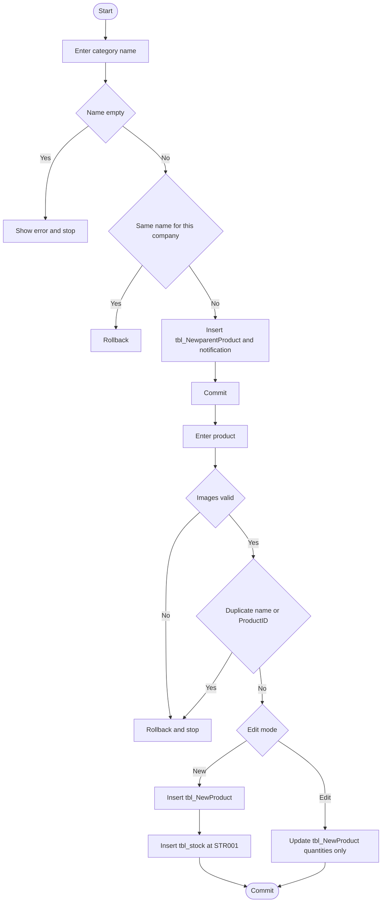

# 01 — Product category and products

## Document control

| Item | Value |
|------|--------|
| Review date | 2026-11-06 |
| Branch | `July_to_Sept26_DevNSupport` |
| HEAD | `026b36ee4e1d292fe7b4c8b81403cd309021af72` |
| Source | `Bill_Software/corporate/business/app/newproductparent.aspx.cs`, `Bill_Software/corporate/business/app/newproduct_master.aspx.cs` |
| Status | Implemented for category and product maintenance. Stock-store meaning is unresolved. |
| Limitation | No database catalog was read. Triggers and constraints are **PENDING VERIFICATION**. |

Master index: [BUSINESS_PROCESS_MASTER_INDEX.md](BUSINESS_PROCESS_MASTER_INDEX.md).

## 1. Business purpose and scope

Product categories and products are the master data for purchase, requisition, quotation, direct proforma, and manual tax invoice. A product row holds the selling identity and a quantity. A separate `tbl_stock` row is created with the product. Those are not the same balance: later purchase and tax-invoice code update them differently. **CONFIRMED IN SOURCE.**

This module does not purchase, invoice, or receive goods.

## 2. Sub-modules and pages

| Action | Page | Entry |
|--------|------|--------|
| List, create, delete category | `newproductparent.aspx` | `Binddata`, `btnSave_Click`, `DataList1_ItemCommand` |
| List, filter, search, create, edit, soft-delete product | `newproduct_master.aspx` | `BindProductsGrid`, `btnSave_Click`, `LoadProductForEdit`, `HandleProductCommand` |

No separate product view or approve page was in the reviewed files. **GAP / NOT IDENTIFIED.**

## 3. Actors

Both pages inherit `SecurePage`. **CONFIRMED IN SOURCE.**

| Page | Permission key |
|------|----------------|
| `newproductparent.aspx.cs` | `newproductparent` |
| `newproduct_master.aspx.cs` | `newproduct_master` |

Both redirect when `Session["USERID"]` is null. No job title is named in these files.

## 4. Preconditions

- `CompanyContext.CurrentCompanyID` is the tenant written and filtered on category and product rows.
- A product category is loaded from `tbl_NewparentProduct` for the current company (`BindCategories`).
- Tax rates for the product form come from `tbl_New_Vat_Master` with no `CompanyID` predicate (`Page_Load`, `DbCL.FillCombo`). **CONFIRMED IN SOURCE.**

## 5. User process

### Category

1. Open `newproductparent.aspx`. The list is `id, ProductOrServiceCat` for the current company.
2. Enter a name. Blank is rejected: "Provide Products Name."
3. Save. A company-scoped trimmed-name duplicate rolls back with "Category already exists for this company."
4. Otherwise the row is inserted and a `tbl_SystemNotification` row (`ModuleCode` `CATEGORY`) is written in the same transaction.
5. Delete looks up the row by `id` and `CompanyID`, deletes it, and writes a notification. Zero rows roll back.

The delete does not query `tbl_NewProduct`. Whether a category in use can be deleted depends on the database. **PENDING VERIFICATION.**

### Product

1. Categories load for the company. The grid shows non-deleted products (`DeleteMode = 0` or null) for the company.
2. Save validates images, then opens a transaction.
3. Duplicate check: same company, not deleted, and either the same trimmed category plus lower-cased name, or the same `ProductID` (`CheckDuplicateProduct`).
4. New products receive an id from `findProductId`: latest `ProductID LIKE 'PRD%'` for the company, then `PRD` plus the numeric tail plus one.
5. Insert `tbl_NewProduct`, then insert `tbl_stock`, then notify, then commit.
6. Edit loads by `Id`, `CompanyID`, and not deleted. Update changes product columns, including both quantity columns. The comment in source says `Id` and `ProductID` are immutable. The update does not touch `tbl_stock`.
7. Delete sets `DeleteMode = 1`, `DeletedOn`, `DeletedByUserId`. It does not delete `tbl_stock` and does not change quantity.

## 6. Process flow

## 7. Source files and methods

| File | Methods | Lines |
|------|---------|-------|
| `Bill_Software/corporate/business/app/newproductparent.aspx.cs` | `btnSave_Click`, `CheckDuplicate`, `DataList1_ItemCommand` | 92–143, 44–54, 145–218 |
| `Bill_Software/corporate/business/app/newproduct_master.aspx.cs` | `ParseProductImages`, `SerializeProductImages` | 203–247 |
| `Bill_Software/corporate/business/app/newproduct_master.aspx.cs` | `findProductId`, `CheckDuplicateProduct` | 337–380 |
| `Bill_Software/corporate/business/app/newproduct_master.aspx.cs` | `BindSharedProductParams` | 153–156 |
| `Bill_Software/corporate/business/app/newproduct_master.aspx.cs` | `btnSave_Click` product insert and stock insert | 725–767 |
| `Bill_Software/corporate/business/app/newproduct_master.aspx.cs` | product update | 783–792 |
| `Bill_Software/corporate/business/app/newproduct_master.aspx.cs` | `HandleProductCommand` soft-delete | 1196–1206 |

## 8. Tables and columns observed

### `tbl_NewparentProduct`

`id`, `ProductOrServiceCat`, `CompanyID`. **CONFIRMED IN SOURCE.**

### `tbl_NewProduct` insert

`Product_code`, `ProductOrServiceCat`, `Purches_Rate`, `Sail_Rate`, `Tax_Rate`, `Product_catagory`, `ProductName`, `Type`, `Unit`, `Brand`, `parentId`, `Specification`, `Quantity`, `Quantity_Num`, `MOQ_Value`, `SaleNote`, `ExpiryDate`, `TimeStamp`, `ProductID`, `AddedbyUserId`, `AddedOn`, `CompanyID`, `ViewMode`, `DeleteMode`, `ImageUrl`, `IsNew`, `IsFastMoving`, `NormalizedProductName`.

`ViewMode` is written as `1`. `DeleteMode` is written as `0`. **CONFIRMED IN SOURCE.**

`BindSharedProductParams` binds `@Quantity` as `SqlDbType.NVarChar` length 100, using the decimal converted to text, and `@QuantityNum` as `SqlDbType.Decimal` with precision 18 and scale 3. Those are ADO.NET parameter types. **CONFIRMED IN SOURCE.**

The SQL column types of `tbl_NewProduct.Quantity` and `tbl_NewProduct.Quantity_Num` are **PENDING VERIFICATION**. Live database or catalog evidence is unavailable. A parameter type does not establish the column type. The comment in `BindSharedProductParams` that mentions UAT column types is not a catalog read.

### `tbl_stock` insert on product create

`Product_id`, `Product_name`, `Quantity`, `Sail_Rate`, `Service_tax_rate`, `ShippedToStoreId`, `ShippedToStoreName`.

`ShippedToStoreId` is the literal `STR001`. `ShippedToStoreName` is the literal `Central Warehouse`. This insert does not set `Quantity_Num` or `CompanyID`. **CONFIRMED IN SOURCE.**

### `tbl_SystemNotification`

`Title`, `Message`, `ModuleCode`, `Severity`, `StartDate`, `EndDate`, `IsActive`, `CreatedBy`, `CompanyID`.

## 9. Writes and transactions

| Action | Writes | Boundary |
|--------|--------|----------|
| Create category | `INSERT tbl_NewparentProduct`, then notification | One `SqlTransaction`. Duplicate or exception rolls back. |
| Delete category | `DELETE` by `id` and `CompanyID`, then notification | Same. Zero rows roll back. |
| Create product | Product insert, stock insert, notification | One transaction. Image files saved before commit are deleted if the transaction fails. |
| Edit product | `UPDATE tbl_NewProduct` by `Id` and `CompanyID` | Same transaction. Zero rows roll back. No `tbl_stock` update. |
| Soft-delete | `UPDATE DeleteMode` | Own transaction. Does not change stock. |

## 10. CompanyID

Category list, duplicate check, insert, lookup, and delete all use `CompanyContext.CurrentCompanyID`. Product grid, id allocation, duplicate check, insert, update, and soft-delete do the same.

`tbl_stock` insert has no company predicate. `tbl_New_Vat_Master` read has none. **CONFIRMED IN SOURCE.**

## 11. Inventory impact

| Action | `tbl_NewProduct` | `tbl_stock` |
|--------|------------------|-------------|
| Create | Sets `Quantity` and `Quantity_Num` to the entered opening quantity | Inserts `Quantity` only, store `STR001` / `Central Warehouse` |
| Edit | Overwrites both quantity columns with the form value | Not updated |
| Soft-delete | Row remains, hidden from the catalog query | Not updated |

Product master quantity and stock quantity can diverge after the first edit or after a later purchase. The authoritative stock balance and the read path that uses it remain **PENDING VERIFICATION**. No trigger or synchronization is inferred. The write-path matrix is in the [master index](BUSINESS_PROCESS_MASTER_INDEX.md). See [02](02_purchase_and_inventory_receipt.md) and [09](09_tax_invoice_ti.md).

## 12. Financial impact

None. Rates (`Purches_Rate`, `Sail_Rate`, `Tax_Rate`) are stored on the product. No payable, receivable, or ledger row is written.

## 13. Status and document links

`DeleteMode` `0` or null means visible. `1` means soft-deleted. Categories have no status column in the reviewed SQL.

Downstream pages read `tbl_NewparentProduct` and `tbl_NewProduct`. They do not read this page's opening-stock row as a ledger.

## 14. Validation

- Category name required; duplicate is company plus trimmed name.
- Product duplicate is company, active row, and (category + normalised name) or `ProductID`.
- Image upload is validated before save (`TryValidateProductImages`, `TryValidateUpload`).
- External image URL must start with `http://`, `https://`, or `~/`.
- Packed image text longer than 500 characters is rejected before insert.

## 15. Image serialization

`ImageUrl` is one string. **CONFIRMED IN SOURCE** in `SerializeProductImages` and `ParseProductImages`:

| Key | Field |
|-----|--------|
| `T` | Top |
| `B` | Bottom |
| `L` | Left |
| `R` | Right |
| `O` | OEM / external URL |

Parts are joined with `|`. A legacy value with no `|` and no `T=`/`B=`/`L=`/`R=`/`O=` prefix is stored as OEM when it is an HTTP URL, otherwise as Top.

Files are saved by `SaveViewImage` for Top, Bottom, Left, and Right. The physical folder is in that method; this document does not invent a path beyond the code that writes `ImageUrl`.

## 16. Defects, risks, and open questions

- Category delete does not check products. **PENDING VERIFICATION** against foreign keys.
- Product edit can change `Quantity` / `Quantity_Num` without changing `tbl_stock`. **CONFIRMED IN SOURCE.**
- Opening stock is forced to `STR001`. Purchase stock uses the ship-to selected on the purchase. Whether `STR001` is the same store is **PENDING VERIFICATION**.
- `findProductId` uses the latest `Id` with a `PRD` prefix, not a lock. Concurrent creates can collide. **INFERENCE** from the select-then-insert pattern.
- VAT master is not company-filtered.

## 17. Related modules

- [02 Purchase](02_purchase_and_inventory_receipt.md) — adds quantity on save.
- [04 PR / PO](04_purchase_requisition_and_po.md) — selects products; no stock post.
- [06 Quotation](06_client_quotation_and_purchase_order.md) — snapshots product lines; no stock post.
- [09 Tax invoice](09_tax_invoice_ti.md) — subtracts `tbl_NewProduct.Quantity`.
