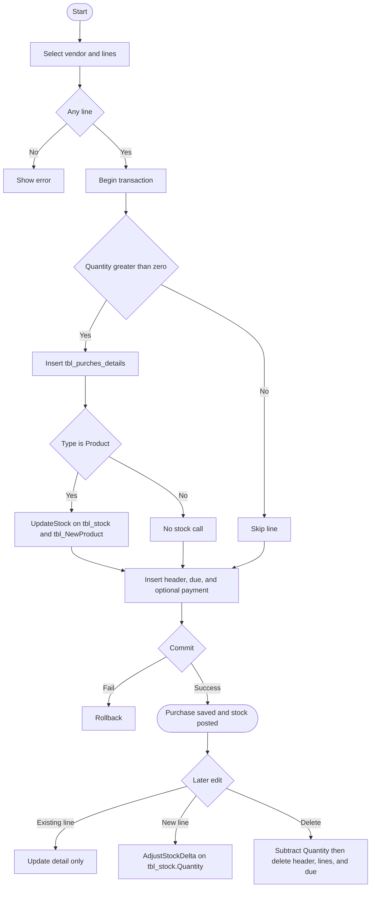

# 02 — Purchase and inventory receipt

## Document control

| Item | Value |
|------|--------|
| Review date | 2026-11-06 |
| Branch | `July_to_Sept26_DevNSupport` |
| HEAD | `026b36ee4e1d292fe7b4c8b81403cd309021af72` |
| Source | `Bill_Software/corporate/business/app/Purches_exting_vendor.aspx.cs`, `Bill_Software/corporate/business/app/EditPurchase.aspx.cs`, `Bill_Software/corporate/business/app/Delete_purtches.aspx.cs` |
| Status | Partially Implemented |
| Limitation | This is direct purchase posting. It is not the missing GRN in [05](05_goods_receipt_grn.md). |

Master index: [BUSINESS_PROCESS_MASTER_INDEX.md](BUSINESS_PROCESS_MASTER_INDEX.md).

## 1. Business purpose and scope

A user records a vendor purchase, its lines, an amount due, and an optional payment. For lines marked Product, save increases stock immediately inside the purchase transaction. There is no separate receipt document in these pages. **CONFIRMED IN SOURCE.**

## 2. Sub-modules and pages

| Action | Page | Entry |
|--------|------|--------|
| Select vendor and products, save | `Purches_exting_vendor.aspx` | `Button3_Click`, `UpdateStock` |
| Search and edit header, lines, and new lines | `EditPurchase.aspx` | `btnSertch_Click`, `UpdatePurchase`, `gd_Service_Product_RowUpdating`, `btn_submit_Click`, `AdjustStockDelta` |
| Search and delete | `Delete_purtches.aspx` | `DeletePurchaseWithStockUpdate` |

`EditPurchase` also contains `gd_Service_Product_RowUpdating_old` and `gd_Service_Product_RowUpdating_old2`. The live GridView handler name is `gd_Service_Product_RowUpdating`. The `_old2` method calls `AdjustStockDelta`; the live handler does not. **CONFIRMED IN SOURCE.**

## 3. Actors

All three classes extend `System.Web.UI.Page`. No `RequiredPermissionKey` is declared. `Session["USERID"]` is stored as `AddedById` / stock `ModifiedByUserId`, defaulting to `admin` or `System` when missing. No role name is in these files.

## 4. Preconditions

- Vendor list: `select Vendor_Name from tbl_Vendor order by Vendor_Name`. No `CompanyID`.
- Vendor id: `SELECT * FROM tbl_Vendor WHERE Vendor_Name = @Name` on the create page. Edit and delete resolve the vendor with concatenated SQL.
- Categories: `SELECT DISTINCT ProductOrServiceCat FROM tbl_NewparentProduct` with no company filter on the create page.
- Products: `tbl_NewProduct` by name, no `CompanyID`, or services from `tbl_Service`.
- Ship-to comes from `DDL_ShippedTo`. The option source is `BindShippedToDropdown`. This review does not treat the dropdown text as a warehouse master.

## 5. User process

### Create (`Button3_Click`)

1. At least one grid row is required.
2. Ids are generated outside the transaction: `PR` + 5 digits from `tbl_Purches.Purches_Id`, and `PN` + 5 digits from `tbl_Purchess_payment.Payment_ID` (`GenerateID`, separate connection, `ORDER BY ID DESC`).
3. Inside one transaction, each grid row with quantity greater than zero inserts `tbl_purches_details`.
4. If the type is `Product`, `UpdateStock` runs for that line before the header insert.
5. Header `tbl_Purches` is inserted. Delivery, TCS, and two other amounts are added into `Total_purches_rate`.
6. If "pay now" is `Yes`, `tbl_Purchess_payment` is inserted.
7. `tbl_purches_due` is always inserted with `grandTotal - paidAmt`.
8. Commit. Failure rolls back. Lines with quantity `<= 0` are skipped and do not fail the save.

### Edit

1. Search by vendor and/or dates. SQL is concatenated and has no `CompanyID`.
2. `UpdatePurchase` updates header fields by `Purches_Id` only. It does not change lines or stock.
3. `gd_Service_Product_RowUpdating` updates an existing `tbl_purches_details` row when `Id > 0`. It does not call `AdjustStockDelta` and does not update `tbl_NewProduct`.
4. `btn_submit_Click` inserts rows whose in-memory `Id` is `0`, then calls `AdjustStockDelta` with the full new quantity as the delta. After commit it recalculates header totals.
5. `btn_viewProds_Click` binds the purchase grid from `public static DataTable Dt`. That field is process-wide mutable state. Cross-user mixing is a potential risk, not a reproduced incident. Detail is in section 9.

### Delete

`DeletePurchaseWithStockUpdate` in one transaction:

1. Subtract each detail quantity from `tbl_stock.Quantity` where `Product_id` matches and `ShippedToStoreId = ShippedToLoc`.
2. Subtract the same quantity from `tbl_NewProduct.Quantity` where `ProductID = Product_id`.
3. Delete `tbl_purches_due`, `tbl_purches_details`, and `tbl_Purches`.

It does not delete `tbl_Purchess_payment`. `Quantity_Num` is not in the update. `updatestock1` is a second, unused path that hardcodes `PR0042`. **CONFIRMED IN SOURCE.**

## 6. Process flow

## 7. Source files and methods

| File | Method | Lines |
|------|--------|-------|
| `Bill_Software/corporate/business/app/Purches_exting_vendor.aspx.cs` | `Button3_Click` | 453–626 |
| `Bill_Software/corporate/business/app/Purches_exting_vendor.aspx.cs` | `UpdateStock` | 628–685 |
| `Bill_Software/corporate/business/app/Purches_exting_vendor.aspx.cs` | `GenerateID` | 687–707 |
| `Bill_Software/corporate/business/app/EditPurchase.aspx.cs` | field `Dt` | 20 |
| `Bill_Software/corporate/business/app/EditPurchase.aspx.cs` | `UpdatePurchase` | 260–291 |
| `Bill_Software/corporate/business/app/EditPurchase.aspx.cs` | `gd_Service_Product_RowUpdating` | 658–763 |
| `Bill_Software/corporate/business/app/EditPurchase.aspx.cs` | `AdjustStockDelta` | 812–839 |
| `Bill_Software/corporate/business/app/EditPurchase.aspx.cs` | `btn_viewProds_Click` | 981–1017 |
| `Bill_Software/corporate/business/app/EditPurchase.aspx.cs` | `btn_submit_Click` | 1198–1298 |
| `Bill_Software/corporate/business/app/Delete_purtches.aspx.cs` | `DeletePurchaseWithStockUpdate` | 166–216 |

## 8. Tables and columns observed

### `tbl_Purches` insert

`Purches_Id`, `Client_Id`, `Total_purches_rate`, `Total_Tax_rate`, `Purches_date`, `Purches_Type`, `Invoice_No`, `Stock_Add_Date`, `Narration`, `InvoiceAmnt`, `TCS_Amount`, `TCS_Rate`, `Delivery_Amount`, `Delivery_Rate`, `otherAmount1_name`, `otherAmount1`, `otherAmount2_name`, `otherAmount2`, `AddedById`, `CreatedDate`, `ShippedToStoreId`, `ShippedToStoreName`, `BuyerOrderNo`, `OrderDate`.

`Client_Id` is the vendor id. **CONFIRMED IN SOURCE.**

### `tbl_purches_details` insert

`sl_no`, `Purches_id`, `Product_id`, `Product_name`, `vendor_rate`, `tax_applicable`, `tax_rate`, `Quantity`, `purches_rate`, `total_purches_rate`, `vat_amount`, `specification`, `DiscountPercent`, `DiscountAmount`, `TaxableAmount`, `ShippedToLoc`, `ShippedDate`, `Purches_date`, `Client_id`.

### `tbl_Purchess_payment` optional insert

`Payment_ID`, `Payment_Date`, `Purchess_ID`, `Purches_Date`, `Client_Id`, `Net_amount`, `Given_amount`, `type`, `Ch_no`, `Ch_bank`, `Ch_date`, `Due_amount`.

### `tbl_purches_due`

`Purches_Id`, `Due_amount`.

### Stock columns written by `UpdateStock`

`tbl_stock`: `Quantity_Num`, `Quantity`, `Sail_Rate`, `Service_tax_rate`, `ShippedDate`, `ModifiedOn`, `ModifiedByUserId`, matched on `Product_id` and `ShippedToStoreId`. Insert when no row is updated adds `Product_name`, `ShippedToStoreName`, `Quantity_Num`, `AddedOn`.

`tbl_NewProduct`: `Quantity_Num`, `Quantity`, `Sail_Rate`, `Tax_Rate`, `ModifiedOn`, `ModifiedByUserId`, matched on `ProductID` only.

`AdjustStockDelta` updates `tbl_stock.Quantity` by adding `@Delta` where `ISNUMERIC(Quantity) = 1`. It does not write `Quantity_Num` or `tbl_NewProduct`.

## 9. Writes and transactions

| Path | Transaction |
|------|-------------|
| Create | Details, stock, header, optional payment, and due share one transaction. Id generation does not. |
| Header edit | Auto-commit. No stock. |
| Existing line edit | Auto-commit. No stock. |
| New lines | Detail insert and `AdjustStockDelta` share a transaction. `RecalcAndUpdateHeader` runs after commit. |
| Delete | Stock subtraction and three deletes share one transaction. Payments are outside it. |

`Bill_Software/corporate/business/app/EditPurchase.aspx.cs` declares `public static DataTable Dt` at line 20. **CONFIRMED IN SOURCE.** `btn_viewProds_Click` assigns that field to `gd_Service_Product.DataSource` and to `ViewState["products"]` (lines 1015–1017).

A public static field lives for the application process, not for one request. Mutable contents are therefore shared by later requests and sessions in that process. That can mix one user's purchase lines into another user's grid or view state. This is a potential data-integrity and concurrency risk. It is not a reproduced incident. No code change is specified here.

## 10. CompanyID

No `CompanyID` predicate or column appears in the purchase insert, `UpdateStock`, edit search, line update, `AdjustStockDelta`, or delete. Vendor, category, and product lookups on these pages are also unscoped. **CONFIRMED IN SOURCE.**

`UpdateStock` matches `tbl_NewProduct.ProductID` with no company. The same product id in more than one company would all be updated. Whether `ProductID` is unique across companies is **PENDING VERIFICATION**.

## 11. Inventory impact

| Event | Effect |
|-------|--------|
| Create, product line, matching stock row | Add quantity to `Quantity_Num` and rewrite `Quantity` from `Quantity_Num` |
| Create, product line, no stock row | Insert `tbl_stock` for that product and store |
| Create, product line | Add the same quantity to `tbl_NewProduct.Quantity_Num` and `Quantity` |
| Create, not Product | No `UpdateStock` call |
| Edit existing line quantity | No stock change in the live handler |
| Add a new line on edit | Add the new quantity to `tbl_stock.Quantity` only |
| Delete | Subtract detail quantity from `tbl_stock.Quantity` and `tbl_NewProduct.Quantity` |

Service lines are not stock-posted on create, but delete still runs the stock update for every detail row that matches a product and store. **CONFIRMED IN SOURCE.**

Zero affected stock rows do not fail the delete. Negative stock is not blocked. Rows where `Quantity` is not numeric are not updated by the delete or by `AdjustStockDelta`.

The authoritative stock balance and the read path that uses it remain **PENDING VERIFICATION**. These statements show writes only. They do not establish a trigger or a sync between `tbl_NewProduct.Quantity`, `tbl_NewProduct.Quantity_Num`, and `tbl_stock.Quantity`. The cross-module matrix is in the [master index](BUSINESS_PROCESS_MASTER_INDEX.md).

## 12. Financial impact

Create stores the purchase total, tax, charges, due, and an optional payment. It does not post a general-ledger journal in these files. **GAP / NOT IDENTIFIED.**

Due is `grandTotal - paidAmt` even when the user did not choose to pay. Later payments are [03](03_purchase_payment_ap.md). Delete removes the due row and leaves payments in place.

## 13. Document relationships

`Purches_Id` links header, details, due, and `tbl_Purchess_payment.Purchess_ID`. There is no `ReqNo` or `PO_Id` column in the reviewed insert lists. A direct purchase is not linked to a vendor PO by these statements. **CONFIRMED IN SOURCE** for the insert column lists. A column that exists but is never written is **PENDING VERIFICATION**.

## 14. Validation

- At least one grid row on create.
- Quantity `<= 0` is skipped, not rejected.
- Invoice number uniqueness is checked in `Button4_Click` (`COUNT` on `tbl_Purches.Invoice_No`) before save. Save itself does not re-check it inside the transaction.
- Edit line math caps discount at the gross amount.
- `AdjustStockDelta` inserts a stock row only when delta is greater than zero and no numeric quantity row exists.

## 15. Unresolved stock and warehouse semantics

- Create keeps `Quantity` and `Quantity_Num` together. Edit-add and delete change `Quantity` only.
- Create matches stock on `Product_id` + `ShippedToStoreId`. Product opening stock hardcodes `STR001` ([01](01_product_category_and_products.md)). If the purchase store differs, create inserts a second stock row and still adds to the product total.
- `ShippedToLoc` on the detail is the dropdown value. Delete joins it to `tbl_stock.ShippedToStoreId`. A renamed or mismatched store does not reverse the row.
- Whether one product has one stock row per store is **PENDING VERIFICATION**. The authoritative balance and read path are unverified.
- `public static DataTable Dt` on the edit page is shared mutable state. Operational impact is a potential concurrency risk, not a reproduced incident.

## 16. Related modules

- [01 Products](01_product_category_and_products.md)
- [03 Purchase payment](03_purchase_payment_ap.md)
- [04 Vendor PO](04_purchase_requisition_and_po.md) — separate document; release does not call `UpdateStock`.
- [05 GRN](05_goods_receipt_grn.md) — not this save.
- [09 Tax invoice](09_tax_invoice_ti.md) — business rule deducts invoiced quantity on every tax invoice. The Delivery Challan skip is a defect in that page, not a purchase-stock rule.
