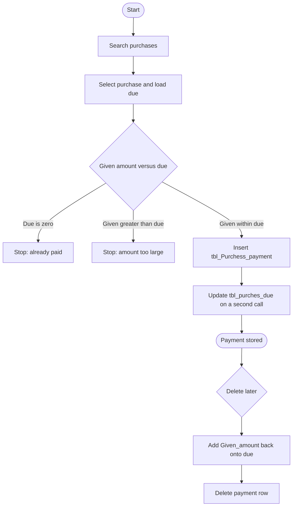

# 03 — Payment against purchase (accounts payable)

## Document control

| Item | Value |
|------|--------|
| Review date | 2026-11-06 |
| Branch | `July_to_Sept26_DevNSupport` |
| HEAD | `026b36ee4e1d292fe7b4c8b81403cd309021af72` |
| Source | `Bill_Software/corporate/business/app/add_payment_purchess.aspx.cs`, `Bill_Software/corporate/business/app/Delete_purches_payment.aspx.cs`, and the optional payment inside `Bill_Software/corporate/business/app/Purches_exting_vendor.aspx.cs` `Button3_Click` |
| Status | Partially Implemented |
| Limitation | Navigation labels are not treated as ledger posting. Only SQL in these files is financial behaviour. |

Master index: [BUSINESS_PROCESS_MASTER_INDEX.md](BUSINESS_PROCESS_MASTER_INDEX.md).

## 1. Business purpose and scope

After a purchase exists, a user can record a further payment against that purchase and reduce `tbl_purches_due`. The user can search and delete a payment, which adds the paid amount back to due. No stock column is updated. **CONFIRMED IN SOURCE.**

This page does not create a vendor bill. The bill, in this codebase, is the purchase header in [02](02_purchase_and_inventory_receipt.md).

## 2. Sub-modules and pages

| Action | Page | Entry |
|--------|------|--------|
| Search purchases, show due and prior payments, save payment | `add_payment_purchess.aspx` | `btnSertch_Click`, `DataList1_ItemCommand`, `Button1_Click`, `InserttotalDate` |
| Search payments and delete | `Delete_purches_payment.aspx` | `btnSertch_Click`, `DataList1_ItemCommand`, `updatedue` |
| Optional payment at purchase save | `Purches_exting_vendor.aspx` | `Button3_Click` when pay-now is `Yes` |

No separate "view payment" page was in the reviewed set. Prior payments are listed on the add page by `Bindpriviouspayment`. **CONFIRMED IN SOURCE.**

## 3. Actors

Both payment pages extend `System.Web.UI.Page`. No permission key and no role name are declared. Vendor search uses `tbl_Vendor` by name with concatenated SQL and no `CompanyID`.

## 4. Preconditions

- A `tbl_Purches` row and a `tbl_purches_due` row. Create-purchase always inserts the due row ([02](02_purchase_and_inventory_receipt.md)).
- `Binddue` reads `Due_amount` from `tbl_purches_due` by `Purches_Id`.
- The payment id is `PN0` plus one more than the max `tbl_Purchess_payment.ID` (`BindpaymentId`). The first id is `PN01` when the table has no row. This differs from purchase-save ids, which are `PN` plus five digits.

## 5. User process

1. Search purchases by vendor, date range, or both. The query joins `tbl_Purches` to `tbl_Vendor` and does not filter `CompanyID`.
2. Select a purchase. The page loads the purchase, the vendor name, the due, and existing payments (`Payment_ID`, `Payment_Date`, `Given_amount`, `type`).
3. Save (`Button1_Click`):
   - Due equal to 0: "Full Amount is Paid for the Purchesse.." and no insert.
   - Given amount greater than due: "Due Amount Is less Than Given Amount..." and no insert.
   - Otherwise `InserttotalDate`.
4. Insert writes `tbl_Purchess_payment`, closes that connection, then runs `update tbl_purches_due set Due_amount='...'` as a second statement.
5. Delete reads `Purchess_ID` and `Given_amount`, adds that amount to `tbl_purches_due.Due_amount`, then deletes the payment by `Payment_ID`.

## 6. Process flow



The two writes are not one transaction. If the due update fails after the insert, the payment exists and the due is unchanged. **CONFIRMED IN SOURCE.**

## 7. Source files and methods

| File | Method | Lines |
|------|--------|-------|
| `add_payment_purchess.aspx.cs` | `Button1_Click` | 181–204 |
| `add_payment_purchess.aspx.cs` | `InserttotalDate` | 206–261 |
| `add_payment_purchess.aspx.cs` | `Binddue`, `Bindpriviouspayment` | 121–141 |
| `add_payment_purchess.aspx.cs` | `BindpaymentId` | 262–287 |
| `Delete_purches_payment.aspx.cs` | `DataList1_ItemCommand`, `updatedue` | 103–131 |
| `Purches_exting_vendor.aspx.cs` | optional payment insert | 583–611 |

## 8. Tables and columns observed

### `tbl_Purchess_payment` insert from the payment page

`Payment_ID`, `Payment_Date`, `Purchess_ID`, `Purchess_Date`, `Client_Id`, `Net_amount`, `Given_amount`, `type`, `Ch_no`, `Ch_bank`, `Ch_date`, `Due_amount`.

`Client_Id` is the vendor id. `Purchess_ID` is the purchase id. `Net_amount` is the purchase amount shown on the form, not the payment. `Due_amount` on the payment row is the due after this payment. **CONFIRMED IN SOURCE.**

Cheque / DD / Online text is stored in `Ch_no`, `Ch_bank`, and `Ch_date`. Cash uses a dated string in `Ch_date` when the selected index is 0. Index 3 is treated as online. **CONFIRMED IN SOURCE.** The index-to-label map is not a database constraint.

### `tbl_purches_due`

`Due_amount` updated by `Purches_Id`.

No general-ledger, bank, or voucher table is named in these methods. **GAP / NOT IDENTIFIED.**

## 9. Writes and transactions

| Action | SQL | Transaction |
|--------|-----|-------------|
| Add | Parameterized `INSERT` into `tbl_Purchess_payment` | Connection closes before the next statement |
| Add | Concatenated `UPDATE tbl_purches_due` | Separate call |
| Delete | Concatenated `UPDATE` due, then concatenated `DELETE` | Separate calls, no rollback pairing |
| Pay-now on purchase save | Parameterized insert of payment and due | Same transaction as the purchase ([02](02_purchase_and_inventory_receipt.md)) |

## 10. CompanyID

The payment insert column list has no `CompanyID`. Search, due read, due update, and delete have no `CompanyID`. Vendor lookup is by name only. **CONFIRMED IN SOURCE.**

## 11. Inventory impact

None. These methods do not reference `tbl_stock`, `tbl_NewProduct`, or `Quantity`.

## 12. Financial impact

- A payment row is the recorded cash, cheque, DD, or online amount against one purchase.
- Due on `tbl_purches_due` is reduced by the given amount on add, and increased by `Given_amount` on delete.
- The payment row also stores the resulting due in its own `Due_amount`. Later payments do not rewrite older payment rows.
- Overpayment is blocked only by the form comparison. The due update itself has no check.
- Delete does not check that the due row exists.
- Purchase delete removes the due row and does not remove payments ([02](02_purchase_and_inventory_receipt.md)). A later payment delete would add onto a missing due row. Affected rows are not checked. **CONFIRMED IN SOURCE** as a missing check, not as a proven data failure.

## 13. Document relationships

```text
tbl_Purches.Purches_Id
  = tbl_purches_due.Purches_Id
  = tbl_Purchess_payment.Purchess_ID
  = tbl_purches_details.Purches_id
```

The vendor is `Client_Id` / `Vendor_Id`. There is no invoice-id column in the payment insert. **CONFIRMED IN SOURCE.**

## 14. Validation

- Block save when due is 0 or given amount exceeds due (`Button1_Click`).
- No check that the purchase belongs to the current company.
- No check that `Given_amount` is numeric before `Convert.ToDouble`. A non-numeric value throws. **CONFIRMED IN SOURCE.**
- Payment id allocation is max-id plus one, outside a transaction.

## 15. Defects and open questions

- Insert and due update are not atomic.
- Due update and payment delete concatenate values into SQL.
- Two id styles exist (`PN00001` from purchase save, `PN0` + integer from this page).
- No `CompanyID`.
- Whether `Due_amount` is numeric, and whether more than one due row can exist per purchase, is **PENDING VERIFICATION**.
- Do not describe this as a full accounts-payable subledger. The reviewed code maintains a due balance and payment rows only.

## 16. Related modules

- [02 Purchase](02_purchase_and_inventory_receipt.md)
- [10 Payment received](10_payment_received_ar.md) — customer side, different tables.
