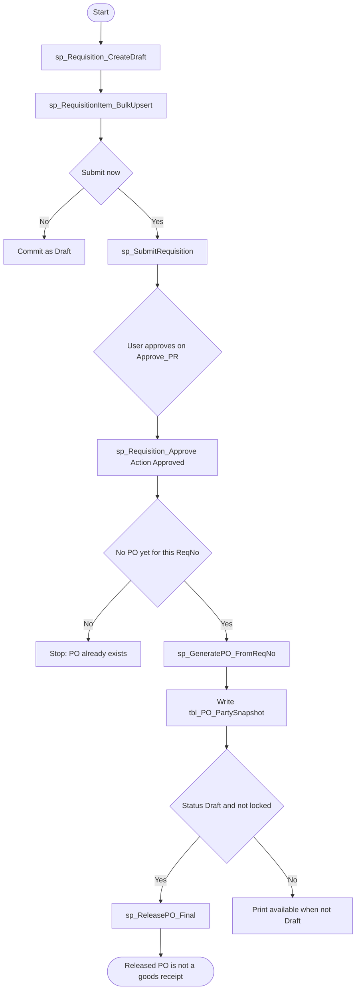

# 04 — Purchase requisition and vendor purchase order

## Document control

| Item | Value |
|------|--------|
| Review date | 2026-11-06 |
| Branch | `July_to_Sept26_DevNSupport` |
| HEAD | `026b36ee4e1d292fe7b4c8b81403cd309021af72` |
| Source | `Bill_Software/corporate/business/app/RequisitionNew.aspx.cs`, `Bill_Software/corporate/business/app/Approve_PR.aspx.cs`, `Bill_Software/corporate/business/app/Generate_PO_From_PR.aspx.cs`, `Bill_Software/corporate/business/app/Generate_PO_Preview.aspx.cs`, `Bill_Software/corporate/business/app/View_PO.aspx.cs`, `Bill_Software/corporate/business/app/View_PO_Details.aspx.cs` |
| Status | Partially Implemented |
| Limitation | `po_view.aspx` is not in the repository. List and release are the two `View_PO*` pages. Procedure bodies were not read. |

Master index: [BUSINESS_PROCESS_MASTER_INDEX.md](BUSINESS_PROCESS_MASTER_INDEX.md).

## 1. Business purpose and scope

A user raises a vendor requisition, submits it, and an approver approves it. A second step generates one vendor PO from that requisition, stores party snapshots, and a later release call locks the PO for print. Release does not receive goods and does not post stock. **CONFIRMED IN SOURCE** for the absence of stock SQL. What `sp_ReleasePO_Final` writes is **PENDING VERIFICATION**.

This PO is `tbl_PO_Header`. It is not the client `PO_Number` on a quotation ([06](06_client_quotation_and_purchase_order.md)).

## 2. Sub-modules and pages

| Action | Page | Entry |
|--------|------|--------|
| Create draft, update draft, submit, cancel draft | `RequisitionNew.aspx` | `PersistRequisition`, `btnCancelPR_Click` |
| List submitted PRs, approve | `Approve_PR.aspx` | `ApprovePR` |
| Open an approved PR that has no PO | `Generate_PO_From_PR.aspx` | `OwnsApprovedPR` |
| Review and create the PO | `Generate_PO_Preview.aspx` | `btnCreatePO_Click`, `SavePartySnapshots` |
| List POs | `View_PO.aspx` | company and `PO_Status` filter |
| Open, release, print | `View_PO_Details.aspx` | `btnReleasePO_Click` |

`Approve_PR` redirects View to `View_PR_Details.aspx?mode=approve`. That page was not in the reviewed set. **GAP / NOT IDENTIFIED** here.

No Reject command exists in `Approve_PR.aspx.cs`. The grid colors a `Rejected` status, but this file never sends that action. **CONFIRMED IN SOURCE.**

## 3. Actors

These classes extend `System.Web.UI.Page`. No permission key is declared.

`Session["USERID"]` is `@CreatedBy`, `@UserId`, or `@ApproverUserId`. The approver is whatever user can open the page and pass the company check. The source does not name an approver role.

## 4. Preconditions

- Vendor: `tbl_Vendor` by name and `CompanyID` (`RequisitionNew`).
- Product category: `tbl_NewparentProduct` for the company. Services: `tbl_Service` with no company filter.
- Product lines: `tbl_NewProduct` by `ParentId` and `CompanyID`.
- VAT list: `tbl_Vat_Master` with no company filter.
- Submit requires rate `> 0`, tax applicable, and GST `> 0` for every submitted line (`ValidateBeforePersist`).
- PO generation requires `tbl_RequisitionMain.Status = 'Approved'` and no `tbl_PO_Header` row for the same `ReqNo` and `CompanyID`.

## 5. User process

### Requisition

1. New save calls `sp_Requisition_CreateDraft` with client name, vendor id, user, and company. `@ReqNo` is an output.
2. The same transaction updates `ExternalERPNo`, `Remarks`, and `Date` on `tbl_RequisitionMain`.
3. `sp_RequisitionItem_BulkUpsert` receives `dbo.RequisitionItem_TVP` (`ProductId`, `ProductName`, `ParentCategoryId`, `HSNCode`, `Description`, `Qnty`, `Rate`, `DiscountPercent`, `DiscountAmount`, `IsTaxApplicable`, `GST`, `ItemOrder`).
4. Draft save commits and the page sets status text to `Draft`.
5. Submit also calls `sp_SubmitRequisition`, notifies, commits, and sets the UI to `Submitted`. Controls are enabled only while status is `Draft` (`ApplyStatusUI`).
6. Cancel, only from Draft, calls `sp_CancelRequisition` and sets the UI to `Cancelled`.

### Approval

The list is `Status = 'Submitted'` and `CompanyID`. Approve calls `sp_Requisition_Approve` with `@Action = 'Approved'` and empty remarks, then inserts a notification, in one transaction.

### PO

1. The generation list is `Status = 'Approved'` and no matching `tbl_PO_Header`.
2. Preview loads the PR header and `tbl_RequisitionNew` lines for the company.
3. `btnCreatePO_Click` re-checks ownership, calls `sp_GeneratePO_FromReqNo`, then sets `tbl_PO_Items.CompanyID` from the header when it differs, then updates header logistics fields, then writes snapshots, then commits.
4. `View_PO` lists `Draft`, `Released`, and `Cancelled` by color. Those values are display cases, not proof that this page sets them.
5. `View_PO_Details` shows release only when `PO_Status` is `Draft` and `IsLocked` is false. Release calls `sp_ReleasePO_Final` with `PO_Id`, user, and company. The call is not inside a `SqlTransaction`. The success text says the PO was approved, released, and locked. Column updates inside the procedure are **PENDING VERIFICATION**.

Print navigates to `Print_PO.aspx` when status is not Draft. Print behaviour was not reviewed.

## 6. Process flow

Existing flow:



Cancel from Draft calls `sp_CancelRequisition` and does not generate a PO. A Reject action is not in `Approve_PR.aspx.cs`.

## 7. Source files and methods

| File | Method | Lines |
|------|--------|-------|
| `RequisitionNew.aspx.cs` | `PersistRequisition` | 762–856 |
| `RequisitionNew.aspx.cs` | `btnCancelPR_Click` | 925–949 |
| `RequisitionNew.aspx.cs` | `ApplyStatusUI` | 979–988 |
| `Approve_PR.aspx.cs` | `ApprovePR` | 140–164 |
| `Generate_PO_From_PR.aspx.cs` | list SQL and `OwnsApprovedPR` | 31–37, 113–120 |
| `Generate_PO_Preview.aspx.cs` | `btnCreatePO_Click` | 259–348 |
| `Generate_PO_Preview.aspx.cs` | `SavePartySnapshots` | 358–379 |
| `View_PO_Details.aspx.cs` | `ApplyStatusUI`, `btnReleasePO_Click` | 145–203 |

## 8. Procedures confirmed as call sites

| Procedure | Caller | Parameters observed |
|-----------|--------|---------------------|
| `sp_Requisition_CreateDraft` | `PersistRequisition` | `@ClientName`, `@VendorId`, `@CreatedBy`, `@CompanyID`, output `@ReqNo` |
| `sp_RequisitionItem_BulkUpsert` | `PersistRequisition` | `@ClientName`, `@ReqNo`, `@UserId`, `@CompanyID`, `@Items` as `dbo.RequisitionItem_TVP` |
| `sp_SubmitRequisition` | `PersistRequisition` | `@ReqNo`, `@UserId`, `@CompanyID` |
| `sp_CancelRequisition` | `btnCancelPR_Click` | `@ReqNo`, `@CancelledBy`, `@CancelReason`, `@CompanyID` |
| `sp_Requisition_Approve` | `ApprovePR` | `@ReqNo`, `@ApproverUserId`, `@Action`, `@Remarks`, `@CompanyID` |
| `sp_GeneratePO_FromReqNo` | `btnCreatePO_Click` | `@ReqNo`, `@UserId`, `@CompanyID` |
| `sp_ReleasePO_Final` | `btnReleasePO_Click` | `@PO_Id`, `@UserId`, `@CompanyID` |

Bodies are **PENDING VERIFICATION**. Status strings the C# sends or compares are `Draft`, `Submitted`, `Approved`, `Cancelled`, and for PO display `Draft`, `Released`, `Cancelled`.

## 9. Tables and columns observed in C#

| Table | Columns named in the reviewed SQL |
|-------|-------------------------------------|
| `tbl_RequisitionMain` | `ReqNo`, `CompanyID`, `Status`, `ExternalERPNo`, `Remarks`, `Date`, `clientName`, `CreatedBy`, `CreatedOn`, `SubmittedOn`, `Vendor`, `VendorId`, `NetAmount`, `ApprovedBy`, `ApprovedOn` |
| `tbl_RequisitionNew` | Selected by `ReqNo` and `CompanyID`. Line columns are passed through the TVP; the table column names inside the procedure are **PENDING VERIFICATION**. |
| `tbl_PO_Header` | `PO_Id`, `ReqNo`, `CompanyID`, `EngineerName`, `DispatchMode`, `DispatchUpto`, `DeliveryBasis`, `FreightTerms`, `Remarks`, `PO_Status`, `IsLocked`, `VendorId`, `CreatedBy` |
| `tbl_PO_Items` | `PO_Id`, `CompanyID` in the fix-up update |
| `tbl_PO_PartySnapshot` | `PO_Id`, `PartyRole`, `SourceTable`, `SourceId`, `Name`, `Address`, `City`, `State`, `Pin`, `GSTNo`, `PANNo`, `ContactPerson`, `ContactNo`, `Email` |

Snapshot roles written by C#: `Vendor`, `BillTo`, `ShipTo`. Source tables named: `tbl_Vendor`, `tbl_Company`, `Stores`, `tbl_Client`. Store snapshots do not filter `CompanyID`. **CONFIRMED IN SOURCE.**

## 10. Writes and transactions

| Step | Boundary |
|------|----------|
| Draft or submit | One transaction around the draft procedure, header update, item upsert, optional submit, and notification |
| Cancel | One transaction around `sp_CancelRequisition` and notification |
| Approve | One transaction around `sp_Requisition_Approve` and notification |
| Generate PO | One transaction around the ownership check, generate procedure, item company fix, header update, and snapshots |
| Release | Single procedure call. No C# transaction |

## 11. CompanyID

PR reads and writes pass `@CompanyID`. PO ownership checks use `CompanyID`. After generation, C# copies header `CompanyID` onto items that differ. Vendor snapshot joins `tbl_Vendor` on id and `CompanyID`. Client snapshot filters `tbl_Client.CompanyID`. Store snapshot does not. **CONFIRMED IN SOURCE.**

## 12. Inventory impact

None of the reviewed methods contain `tbl_stock`, `tbl_NewProduct.Quantity`, or `UpdateStock`. **CONFIRMED IN SOURCE.**

A procedure could still post stock. That was not verified. **PENDING VERIFICATION.** Until a goods-receipt document exists, do not treat PO release as receipt. See [05](05_goods_receipt_grn.md).

## 13. Financial impact

Header amounts are carried on the PR (`NetAmount` is selected). PO preview totals are computed for display. No `tbl_Purches`, `tbl_purches_due`, or payment insert exists in these files. **GAP / NOT IDENTIFIED** as AP posting.

## 14. Document relationships

```text
tbl_RequisitionMain.ReqNo
  -> tbl_RequisitionNew.ReqNo
  -> tbl_PO_Header.ReqNo
       -> tbl_PO_Items.PO_Id
       -> tbl_PO_PartySnapshot.PO_Id
```

One approved PR can generate a PO only while no header exists for that `ReqNo` and company. The check is in C# before `sp_GeneratePO_FromReqNo`. Whether the procedure also enforces it is **PENDING VERIFICATION**.

Direct purchase in [02](02_purchase_and_inventory_receipt.md) does not store `ReqNo` in its insert list.

## 15. Validation

- Company context required before persist.
- Submit: rate, tax applicable, GST.
- Draft UI locked after submit.
- Approve only when status is `Submitted` for the company (`OwnsSubmittedPR`).
- PO create only when approved and no PO yet.
- Release page shows the button only for Draft and not locked. The procedure is still called if the user posts; the page re-checks the PO belongs to the company, not that it is still Draft. **CONFIRMED IN SOURCE.**

## 16. Defects and open questions

- Reject is not implemented on the approve page.
- Release is not transactional in C# and exposes `ex.Message`.
- Store snapshot is not company-scoped.
- Procedure effects on status and `IsLocked` need a database read.
- No partial PO, PO change, or PO cancel method was in the reviewed pages. `Cancelled` is only a color case on the list.

## 17. Related modules

- [01 Products](01_product_category_and_products.md)
- [02 Direct purchase](02_purchase_and_inventory_receipt.md) — stock posts here, not on PO release.
- [05 GRN](05_goods_receipt_grn.md)
- [06 Client quotation](06_client_quotation_and_purchase_order.md) — different PO.
