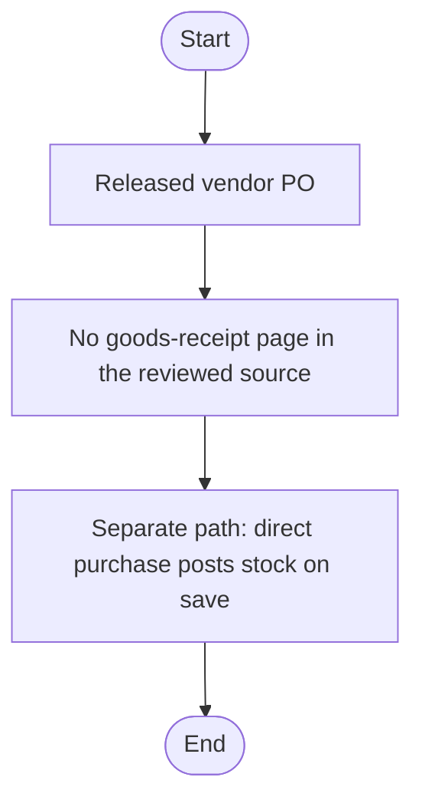
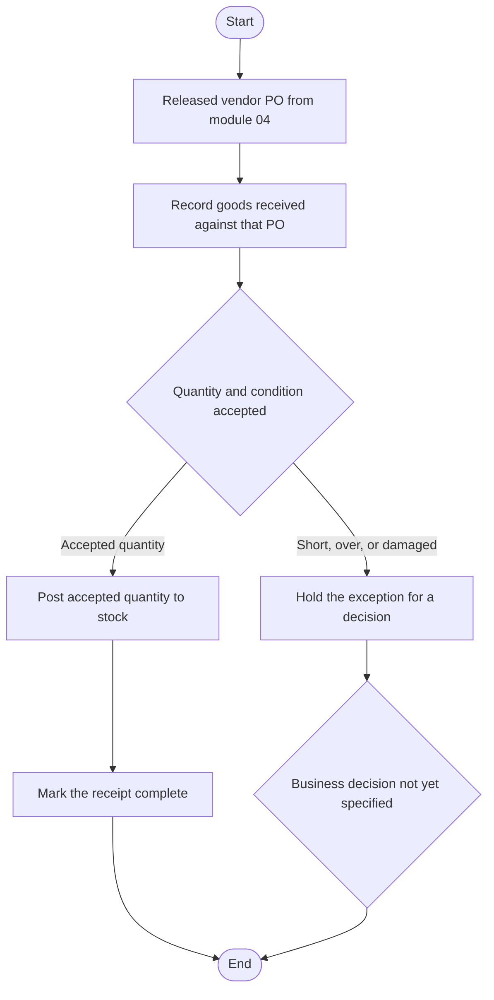

# 05 — Goods receipt (GRN)

## Document control

| Item | Value |
|------|--------|
| Review date | 2026-11-06 |
| Branch | `July_to_Sept26_DevNSupport` |
| HEAD | `026b36ee4e1d292fe7b4c8b81403cd309021af72` |
| Source scope | The PR/PO pages in [04](04_purchase_requisition_and_po.md) and the direct-purchase pages in [02](02_purchase_and_inventory_receipt.md) |
| Status | Gap |
| Limitation | This file separates confirmed absence in the reviewed files from a proposed target flow. The target flow is not implemented behaviour. |

Master index: [BUSINESS_PROCESS_MASTER_INDEX.md](BUSINESS_PROCESS_MASTER_INDEX.md).

## 1. Business purpose and scope

A goods receipt would be the document that records what arrived against a released vendor PO, checks quantity and condition, and posts stock. That document was not found in the reviewed source.

What does exist is direct purchase stock posting ([02](02_purchase_and_inventory_receipt.md)). That path creates `tbl_Purches` and updates stock at save time. It does not reference `tbl_PO_Header`. Vendor PO release ([04](04_purchase_requisition_and_po.md)) calls `sp_ReleasePO_Final` and contains no stock statement.

## 2. Evidence

| Claim | Label |
|-------|--------|
| No page named GRN, goods receipt, or material receipt was in the required file list, and `po_view.aspx` does not exist | GAP / NOT IDENTIFIED |
| `View_PO_Details.btnReleasePO_Click` calls `sp_ReleasePO_Final` and does not mention `tbl_stock` or `tbl_NewProduct` | CONFIRMED IN SOURCE |
| `Purches_exting_vendor.UpdateStock` posts stock without a PO id | CONFIRMED IN SOURCE |
| No GRN table, status, or procedure name appears in the reviewed PO or purchase code-behind | GAP / NOT IDENTIFIED in those files |
| A trigger or unreviewed page could still post stock on PO release | PENDING VERIFICATION |
| The diagram in section 6 is a target. It is not a description of a page that exists | Proposed only |

No table name, column, status value, page, or procedure is invented below as if it existed.

## 3. Sub-modules and pages

| Step | Reviewed result |
|------|-----------------|
| Create GRN | Not identified |
| Edit GRN | Not identified |
| View / search GRN | Not identified |
| Delete GRN | Not identified |
| Approve / post GRN | Not identified |
| Quality or warehouse allocation screen | Not identified |

## 4. Actors

Not identified. Do not copy PO or purchase permissions into this gap.

## 5. Existing flow



PO release is not goods receipt. Direct purchase is not a GRN against a PO.

## 6. Proposed target flow

The following is a recommended future process. It is not confirmed behaviour, and it names no table or page that was not already confirmed elsewhere.



## 7. Intended handoff

```text
Released PO  ->  Goods receipt  ->  quantity and quality check
             ->  stock posting  ->  receipt complete
```

Only "Released PO" is implemented, and only as the release call in [04](04_purchase_requisition_and_po.md). The rest of the chain is proposed.

Direct purchase remains a second, already implemented way to increase stock. A future GRN must not be documented as a replacement until a design says so.

## 8. Inventory and financial impact

| Path | Inventory | Financial |
|------|-----------|-----------|
| Reviewed PO release | No stock SQL in the page | No AP SQL in the page |
| Reviewed direct purchase | Stock increases on save | Due and optional payment |
| Proposed GRN | Not implemented | Not implemented |

Tax Invoice stock deduction ([09](09_tax_invoice_ti.md)) is a sales-side event. It is not a substitute for GRN.

## 9. Unresolved requirements

These are open requirements, not designed fields:

- Partial receipt against a PO line
- Over-receipt and short-receipt
- Damaged or rejected quantity
- Warehouse or store allocation
- PO cancellation after release
- Purchase returns
- A stock ledger that stays aligned with `tbl_stock` and `tbl_NewProduct`
- Accounting integration to the purchase and AP documents
- Whether PO release already changes stock inside `sp_ReleasePO_Final` (**PENDING VERIFICATION**)

## 10. What must not be assumed

- Do not treat `UpdateStock` as GRN posting.
- Do not treat `sp_ReleasePO_Final` as receipt posting.
- Do not add status values such as Received, QC Hold, or Posted until a specification names them.
- Do not invent a GRN header or detail table.

## 11. Related modules

- [02 Direct purchase stock posting](02_purchase_and_inventory_receipt.md)
- [04 Vendor PO release](04_purchase_requisition_and_po.md)
- [01 Product and stock rows](01_product_category_and_products.md)
- [09 Tax invoice deduction](09_tax_invoice_ti.md)
