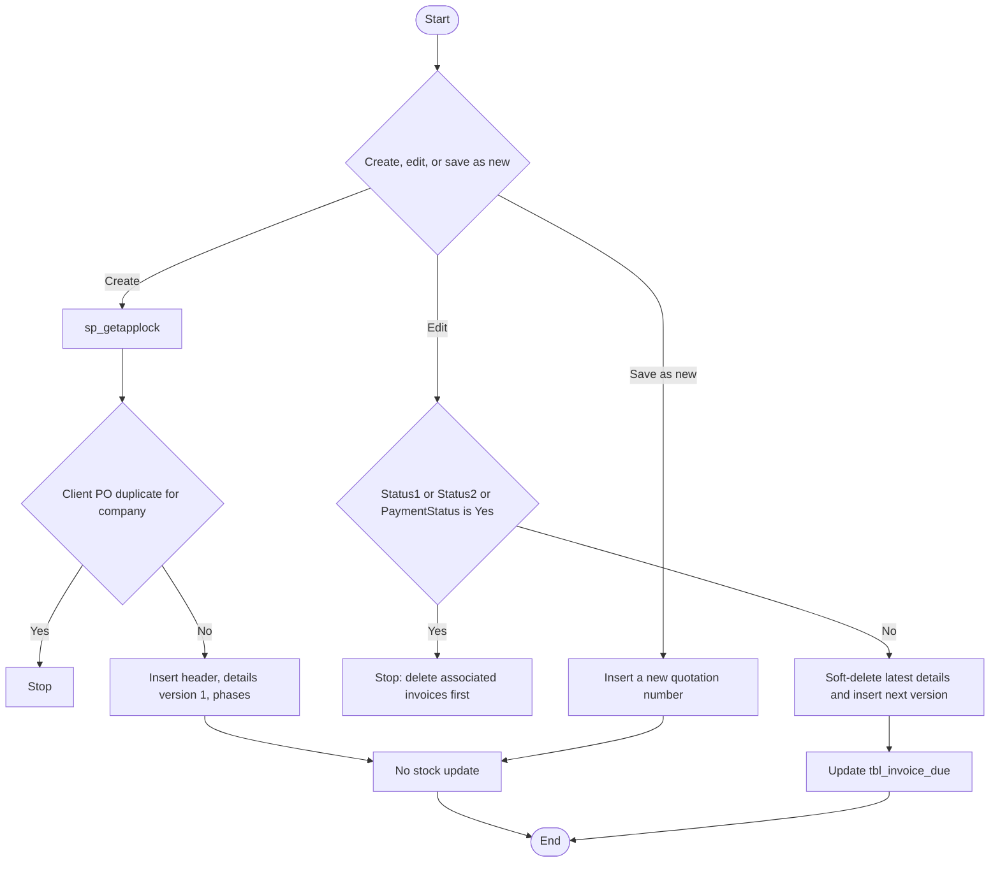

# 06 — Client quotation and client purchase-order reference

## Document control

| Item | Value |
|------|--------|
| Review date | 2026-11-06 |
| Branch | `July_to_Sept26_DevNSupport` |
| HEAD | `026b36ee4e1d292fe7b4c8b81403cd309021af72` |
| Source | `Bill_Software/corporate/business/app/Create_quotation.aspx.cs`, `Bill_Software/corporate/business/app/Edit_quatation.aspx.cs`, `Bill_Software/corporate/business/app/Seartch_quotation.aspx.cs`, `Bill_Software/corporate/business/app/View_quotation.aspx.cs` |
| Status | Partially Implemented |
| Limitation | Detail table is spelled `tbl_Quotaion_details` in the SQL text. |

Master index: [BUSINESS_PROCESS_MASTER_INDEX.md](BUSINESS_PROCESS_MASTER_INDEX.md).

## 1. Business purpose and scope

A user creates a client quotation or a client purchase-order record, with product or service lines, terms, and payment phases. The same header stores optional client PO and DO numbers. That record is the source for a delivery challan, a proforma, a tax invoice, and a customer receipt.

No stock column is updated. **CONFIRMED IN SOURCE.**

The client `PO_Number` is not `tbl_PO_Header` from [04](04_purchase_requisition_and_po.md).

## 2. Sub-modules and pages

| Action | Page | Entry |
|--------|------|--------|
| Create quotation or client PO | `Create_quotation.aspx` | `Button3_Click` calls `MagicianNew` |
| Search | `Edit_quatation.aspx`, `Seartch_quotation.aspx` | `btnSertch_Click` |
| Edit latest lines in place | `Edit_quatation.aspx` | `btnSabe_Click` calls `DataUpdaterMethod` |
| Save as a new document | `Edit_quatation.aspx` | `btnNew_Click` calls `MagicianNew` |
| View and export | `View_quotation.aspx` | list and Excel SQL |
| Delete | No hard delete in these files. Edit soft-deletes previous detail versions | `DataUpdaterMethod` |

`Seartch_quotation` filters `RecordType = 'Quotation'`. Create can also store `RecordType` from the form, including the duplicate check for `'Purchase Order'`. **CONFIRMED IN SOURCE.**

## 3. Actors

The four classes extend `System.Web.UI.Page`. No permission key is declared.

Create stores `Session["USERID"]` as `AddedById`, or `FLM03` when the session value is missing. A salesperson list is loaded from `tbl_login` for the company, excluding `admin` and `AT01`. That list is a selected person, not a proven role check.

## 4. Preconditions

- Client: `tbl_Client` by `CompanyID` on create. Edit loads clients with no `CompanyID` (`FillCombo` / `FillComboNew`).
- Category: `tbl_NewparentProduct` by `CompanyID` on create. Edit uses `order by ProductOrServiceCat` with no company filter.
- Product picker on create: `tbl_NewProduct` by category and `CompanyID`. Edit product picker has no `CompanyID`.
- Place of supply: `tbl_City`, no company filter.
- Payment phase master: `tbl_PaymentPhase`.
- Optional visit: `tbl_SalesVisitReport` by id and `CompanyID` (`PreFillClientFromVisit`).

## 5. User process

### Create

1. Choose client, record type, dates, validity, delivery, packing, GST place, remarks, and optional PO/DO (`DO_Number`, `PO_Number`, `PO_Date`).
2. Add product lines. Each line keeps `ItemNo`, material number, pack size, department, delivery date, rate, discount, tax, and specification. The line stores the product text and ids as entered; it does not reduce `tbl_NewProduct.Quantity`.
3. Add payment phases (`phase_type`, `PhaseDesc`, `amountper`) and primary services.
4. `MagicianNew` takes an exclusive `sp_getapplock` on `Lock_Quotation_` plus the quotation number.
5. For a client PO, a duplicate check counts `tbl_Quotation` rows with the same `DO_Number`, `PO_Number`, converted `PO_Date`, `RecordType = 'Purchase Order'`, and `CompanyID`.
6. One transaction inserts detail version `1`, `IsDeleted = 0`, `IsLatest = 1`, header with `PaymentStatus = 'No'`, phases, services, terms, and a notification.

### Edit

1. Search is concatenated and does not filter `CompanyID` or `IsLatest`.
2. Opening a quotation loads details where `IsLatest = 1` and `IsDeleted = 0`. The detail query does not filter `CompanyID`.
3. `DataUpdaterMethod` blocks the update when `Status1`, `Status2`, or `PaymentStatus` is `Yes`. The message says to delete associated invoices first. The check itself has no `CompanyID`.
4. It reads `MAX(Version) + 1` from details, sets current latest rows to `IsDeleted = 1` and `IsLatest = 0`, inserts the grid as the new version with `IsLatest = 1`, and updates the header. The new detail insert and the header update do not include `CompanyID` in the column list.
5. It also runs `updatedueamountdetails`, which sets `tbl_invoice_due.Due_amount` to the new net by `qutation_no`.

### Save as new

`btnNew_Click` calls `MagicianNew` in `Edit_quatation.aspx.cs`. That insert writes a new `Quotation_no` and detail version `1`. The detail and header inserts in this method do not include `CompanyID`. Primary service insert does. **CONFIRMED IN SOURCE** at the insert column lists around lines 2058–2105 and 2220.

## 6. Process flow

## 7. Source files and methods

| File | Method | Lines |
|------|--------|-------|
| `Create_quotation.aspx.cs` | duplicate PO check | 441 |
| `Create_quotation.aspx.cs` | `MagicianNew` lock, detail insert, header insert | 489–610 |
| `Create_quotation.aspx.cs` | `insertPaymentPhaseNew` | 859–869 |
| `Edit_quatation.aspx.cs` | load latest details | 144 |
| `Edit_quatation.aspx.cs` | `DataUpdaterMethod` | 978–1118 |
| `Edit_quatation.aspx.cs` | `btnNew_Click`, `MagicianNew` | 1821, 1999–2105 |
| `Seartch_quotation.aspx.cs` | company filter on quotation search | 104–148 |
| `View_quotation.aspx.cs` | company filter and PO/DO export columns | 38–49, 221–233 |

## 8. Tables and columns observed

### `tbl_Quotation` create insert

`Quotation_no`, `Quotation_date`, `Client_Id`, `Gross`, `Service_tax`, `Net_amount`, `Status1`, `Status2`, `Sl_no`, `status3`, `service_tax1`, `sub_total`, `cgstOrsgst`, `igst`, `PlaceofSupply`, `PaymentStatus`, `ReferenceData`, `ReferenceName`, `ReferenceId`, `ReferenceDate`, `ValidityDays`, `DeliveryTenure`, `PackingCharges`, `Remarks`, `DetailedView`, `RecordType`, `DO_Number`, `PO_Number`, `PO_Date`, `Validity_StartDate`, `Validity_EndDate`, `AddedById`, `DiscountView`, `TCS_Amount`, `TCS_Percent`, `Freight_Amount`, `Freight_VAT_Percent`, `OtherCharge_Name`, `OtherCharge_Amount`, `VisitId`, `SalesPersonId`, `CompanyID`.

`PaymentStatus` is inserted as `'No'`. **CONFIRMED IN SOURCE.**

### `tbl_Quotaion_details` create insert

`Sl_no`, `Quotation_no`, `Product_id`, `Product_Code`, `Product_name`, `Quantity`, `sail_rate`, `Service_tax_rate`, `Total_sail_rate`, `Total_sail_rate1`, `Total_sail_rate2`, `specification`, `Misc`, `InvStatus`, `Type`, `Unit`, `ProductOrServiceCat`, `discount_rate`, `new_sailrate`, `ItemRemarks`, `ItemNo`, `MaterialNo`, `PackSize`, `DeliveryDate`, `Department`, `AddedById`, `Version`, `IsDeleted`, `IsLatest`, `CompanyID`.

Create sets `Version = 1`, `IsDeleted = 0`, `IsLatest = 1`. Product name, code, rate, and specification are the snapshot stored on the line.

### Related tables

`tbl_QutPaymentPhase`, `tbl_QutPrimaryService`, `tbl_QuoPserTerm`, `tbl_QuoPriSerTogather`, `tbl_PaymentPhase`, `tbl_PrimaryServiceTerms`. Create writes `CompanyID` on the phase and service rows it inserts. Edit save-as-new writes `CompanyID` on `tbl_QutPrimaryService` only among those inserts.

Edit also reads or writes `tbl_invoice_due` and `tbl_quotation_vat`.

## 9. Writes and transactions

| Action | Boundary |
|--------|----------|
| Create | `sp_getapplock` on the connection, then one `SqlTransaction` for lines, header, phases, services, and notification. Lock failure returns before the transaction. |
| Edit version | Several `DbCL` calls. The soft-delete and the inserts are not shown inside one `SqlTransaction` in `DataUpdaterMethod`. **CONFIRMED IN SOURCE.** |
| Save as new | One transaction around its own `MagicianNew` inserts. |

## 10. CompanyID

| Path | Company filter or column |
|------|--------------------------|
| Create header, details, phases, services | Written |
| Create client and product lookups | Filtered |
| `Seartch_quotation` grid | `q.CompanyID = @CompanyID` |
| `View_quotation` list and export | `q.CompanyID` concatenated into the SQL text |
| Edit search | Not filtered |
| Edit detail load and version insert | `IsLatest` / `IsDeleted` only; insert list omits `CompanyID` |
| Edit header update | `WHERE Quotation_no = @QNo` only |
| Edit client and product dropdowns | Not filtered |
| Save-as-new header and details | Insert list omits `CompanyID` |

## 11. Inventory impact

None. Create, edit, and save-as-new do not reference `tbl_stock` or `tbl_NewProduct.Quantity` updates. Quoted quantity is a commercial quantity. Delivery control is [07](07_delivery_challan_dpcc.md). Invoice control is [09](09_tax_invoice_ti.md).

## 12. Financial impact

The header stores gross, tax, net, TCS, freight, and other charges. `PaymentStatus` starts as `No`. A receipt later sets it to `Yes` ([10](10_payment_received_ar.md)). Edit of the net rewrites `tbl_invoice_due` for that quotation number. No cash row is created here.

`Status1 = Yes` is set by quotation-based proforma save. `Status2` is set back to `No` by tax-invoice delete. Those writers are the downstream modules.

## 13. Status and downstream documents

| Field | Meaning in the reviewed writers |
|-------|----------------------------------|
| `PaymentStatus` | `No` on create. `Yes` on every receipt save in `add_payment.aspx.cs`. `No` again when the last payment is deleted. |
| `Status1` | Set to `Yes` when a quotation-based proforma is saved. Set to `No` when that proforma is deleted. |
| `Status2` | Compared as `Yes` to block quotation edit. Delete invoice sets it to `No`. The reviewed invoice insert does not set it to `Yes`. |
| Detail `IsLatest` / `IsDeleted` / `Version` | Edit keeps history by soft-delete plus a new version. |
| `InvStatus` | Create sets the column. Delete invoice can set it back to `No` on matching lines. |
| `RecordType` | Distinguishes a quotation from a client PO record in search and duplicate checks. |
| `PO_Number`, `DO_Number`, `PO_Date` | Client document references on the quotation header. |

Downstream: [07](07_delivery_challan_dpcc.md) reads latest details. [08](08_proforma_invoice_pi.md) reads the header. [09](09_tax_invoice_ti.md) reads details without an `IsLatest` filter. [10](10_payment_received_ar.md) receives money against `Quotation_no`.

## 14. Validation

- Create uses an application lock and, for client PO records, a company-scoped duplicate of DO + PO + PO date.
- Edit is blocked when proforma, invoice, or payment status is `Yes`.
- Versioning applies only to the edit path, not to save-as-new.
- Search on `Seartch_quotation` is quotations only. Client PO records are not in that grid's `RecordType` filter.

## 15. Defects and open questions

- Edit search, edit writes, and save-as-new header/detail inserts omit `CompanyID`.
- `DataUpdaterMethod` is not one transaction.
- Edit updates due even when the user only changed commercial lines.
- `Status2 = Yes` blocks edit, but the tax-invoice insert reviewed in [09](09_tax_invoice_ti.md) writes invoice `status1 = 'No'` and `status2 = 'Active'` and does not update quotation `Status2`. Whether another page sets quotation `Status2` is **GAP / NOT IDENTIFIED** in the reviewed files.
- Latest-version rules used by challan are not used by the tax-invoice quotation query.

## 16. Related modules

- [04 Vendor PO](04_purchase_requisition_and_po.md)
- [07 Delivery challan](07_delivery_challan_dpcc.md)
- [08 Proforma](08_proforma_invoice_pi.md)
- [09 Tax invoice](09_tax_invoice_ti.md)
- [10 Payment received](10_payment_received_ar.md)
