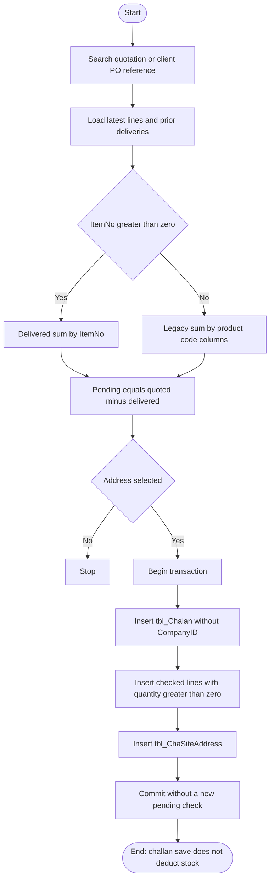

# 07 — Delivery challan (DPCC)

## Document control

| Item | Value |
|------|--------|
| Review date | 2026-11-06 |
| Branch | `July_to_Sept26_DevNSupport` |
| HEAD | `026b36ee4e1d292fe7b4c8b81403cd309021af72` |
| Source | `Bill_Software/corporate/business/app/add_chalan.aspx.cs` |
| Status | Partially Implemented |
| Limitation | Search, view, and delete pages for challans were not in the reviewed file list. |

Master index: [BUSINESS_PROCESS_MASTER_INDEX.md](BUSINESS_PROCESS_MASTER_INDEX.md).

## 1. Business purpose and scope

A delivery challan records how much of a quotation's latest lines is delivered to a selected address. It controls delivery quantity against earlier challans. `Button1_Click` in `Bill_Software/corporate/business/app/add_chalan.aspx.cs` does not update `tbl_NewProduct` or `tbl_stock`. **CONFIRMED IN SOURCE.** Delivery itself does not deduct stock.

Invoice quantity is a different control, stored on invoice tables. The business rule is that the later Tax Invoice deducts the invoiced quantity whether or not a challan exists. The observed tax-invoice save skips that deduction when the source type is Delivery Challan. That skip is an implementation defect on the invoice page ([09](09_tax_invoice_ti.md)). It is not behaviour of this challan save.

## 2. Sub-modules and pages

| Action | Page | Entry |
|--------|------|--------|
| Search quotation or client PO, select address, save challan | `add_chalan.aspx` | `btnSertch_Click`, `DataList1_ItemCommand`, `Button1_Click` |

Create is the only challan action in the reviewed file. Edit, delete, and a standalone view page were **GAP / NOT IDENTIFIED** in this scope. Past challans for the quotation are listed by `BindPastChallanHistory`.

## 3. Actors

`add_chalan.aspx.cs` extends `System.Web.UI.Page`. No permission key and no role name are declared.

## 4. Preconditions

- A quotation header in `tbl_Quotation`, with latest detail rows (`IsDeleted = 0`, `IsLatest = 1`, `CompanyID`).
- A client id on that header.
- At least one selected delivery address before save.
- Prior deliveries, when present, in `tbl_Chalan` / `tbl_Challan_details` for the same quotation number and company.

The search query does not filter `tbl_Quotation.CompanyID`. Client name is resolved by `Client_Name` only. **CONFIRMED IN SOURCE** (`btnSertch_Click`, `BuindCompanyId`).

## 5. User process

1. Search by client, record type, date, and/or document number (`Quotation_no`, `PO_Number`, or `DO_Number`).
2. Select a quotation. `Binddetails` loads the header. `Bindquotationdetails` loads latest lines and pending quantity. `BindPastChallanHistory` lists earlier challans.
3. Addresses are loaded from `tbl_Client`, `tbl_Factory`, and `tbl_ClientRegAddress` by client id, with concatenated SQL and no `CompanyID`.
4. The grid shows quoted quantity, delivered quantity, and pending quantity. The user checks lines and types a delivery quantity.
5. Save requires a selected address and a non-empty line table.
6. One transaction inserts `tbl_Chalan`, checked lines with quantity `> 0` into `tbl_Challan_details`, and selected addresses into `tbl_ChaSiteAddress`, then commits.
7. The save does not re-read delivered quantity inside the transaction.

## 6. Quantity rules on load

`Bindquotationdetails` uses `GetAllDeliveredQuantities`. **CONFIRMED IN SOURCE.**

| Case | Match |
|------|--------|
| Quotation `ItemNo` parses to an integer greater than 0 | Sum of delivered quantity for that item number |
| Item number null, blank, or 0 | Sum of legacy aggregates whose product column equals the quotation product code (`Product_Code`). The code comments that historical rows swapped `Product_id` and `Product_code`, and that quotation `Product_id` may be an HSN and is not used for this match |

Pending quantity is quoted minus delivered. The comment in `Bindquotationdetails` says negative values are preserved. **CONFIRMED IN SOURCE.**

`GetAllDeliveredQuantities` sums challan details joined to `tbl_Chalan` where both sides filter `CompanyID`.

## 7. Process flow



## 8. Source files and methods

All methods are in `Bill_Software/corporate/business/app/add_chalan.aspx.cs`.

| Method | Role | Lines |
|--------|------|-------|
| `btnSertch_Click` | Search without company filter | 42–105 |
| `DataList1_ItemCommand` | Calls `Bindquotationdetails` | 164–182 |
| `Bindquotationdetails` | Latest lines, item match, pending | 659–805 |
| `GetAllDeliveredQuantities` | Company-scoped delivered sums | 424–449 |
| `Button1_Click` | Save | 1285–1383 |
| `bindFactoryAddress`, `bindAddress`, `bindRegAddress` | Address lookups | 1210–1253 |

`Bindquotationdetails_OLD`, `_OLD2`, and `_New` are present and are not called from `DataList1_ItemCommand`.

## 9. Tables and columns observed

### Load

`tbl_Quotaion_details`: `Quotation_no`, `IsDeleted`, `IsLatest`, `CompanyID`, `Sl_no`, `Product_id`, `Product_Code`, `Product_name`, `specification`, `Quantity`, `sail_rate`, `Service_tax_rate`, `Total_sail_rate2`, `ItemNo`, `MaterialNo`, `PackSize`, `Department`, `DeliveryDate`.

`tbl_Chalan`: `Chalan_No`, `Quotation_No`, `CompanyID`, `Chalan_Date`, `Client_ID`, `Sl_no`, `ID`.

`tbl_Challan_details`: `Challan_no`, `CompanyID`, `ItemNo`, `Product_id`, `Product_code`, `Quantity`, `Sl_no`, `Product_name`, `MaterialNo`, `PackSize`.

`tbl_ChaSiteAddress`: `Cha_no`, `SiteAddress`.

### Save inserts

`tbl_Chalan`: `Chalan_No`, `Chalan_Date`, `Quotation_No`, `Quotation_Date`, `Client_ID`, `Sl_no`.

`tbl_Challan_details`: `Sl_no`, `Challan_no`, `Product_id`, `Product_code`, `Product_name`, `Quantity`, `ItemNo`, `MaterialNo`, `PackSize`.

`tbl_ChaSiteAddress`: `Cha_no`, `SiteAddress`.

`CompanyID` is not in these three insert lists. **CONFIRMED IN SOURCE.**

On save, the grid label `Product_code` is written to `Product_id`, and the grid label `product_id` is written to `Product_code`. **CONFIRMED IN SOURCE** at lines 1352–1353. That matches the comment that the two columns have been swapped historically.

## 10. Writes and transactions

`Button1_Click` uses one `SqlTransaction` for header, details, and addresses. Challan number generation (`BindInvoiceNo` / count checks) runs before that transaction. There is no second statement that re-sums delivered quantity before insert. Two users can each load the same pending quantity and both commit. **INFERENCE** from the missing revalidation, not from a reproduced race.

## 11. CompanyID

| SQL | Company predicate |
|-----|-------------------|
| Quotation search | No |
| Client id by name | No |
| Latest detail load | Yes |
| Delivered-quantity sum | Yes on challan header and detail |
| Address lookups | No |
| Header, detail, and address inserts | Column omitted |
| Challan number lookup `SELECT TOP 1 ... ORDER BY ID DESC` | No company predicate in the query at line 1448 |

Later tax-invoice load of a challan requires `tbl_Challan_details.CompanyID` ([09](09_tax_invoice_ti.md)). Rows inserted without `CompanyID` may be invisible to that query if the column has no default. That outcome is **PENDING VERIFICATION**.

## 12. Inventory impact

No update of `tbl_NewProduct` or `tbl_stock` on challan save. Delivery quantity is a logistics limit against the quotation. It is not an inventory issue, and it is not a stock deduction.

| Control | Compared with | Stock on this page |
|---------|---------------|--------------------|
| Challan pending | Quoted latest quantity minus prior challan quantity | No deduction. **CONFIRMED IN SOURCE** |
| Later tax invoice | Invoiced quantity against the selected source document | Not performed here. The business rule requires the tax invoice to deduct that quantity, including when the source is this challan. The invoice page currently skips that update for Delivery Challan. Defect on [09](09_tax_invoice_ti.md), not a challan write |

A quotation can be delivered on a challan and later invoiced from the quotation, or invoiced from the challan. Those invoice sources do not share one pending pool, because each invoice stores the selected document number in `tbl_Invoice.Quotation_No` ([09](09_tax_invoice_ti.md)). Under the business rule, both invoices should deduct stock. The observed Delivery Challan skip means the challan-sourced invoice does not. The challan row itself still does not deduct stock.

## 13. Financial impact

None in this page. No rate, tax, due, or payment is inserted. Rates are loaded for display from the quotation line.

## 14. Document relationships

```text
tbl_Quotation.Quotation_no
  -> tbl_Chalan.Quotation_No
       -> tbl_Challan_details.Challan_no
       -> tbl_ChaSiteAddress.Cha_no
```

Client PO and DO numbers are search keys on the quotation. They are not copied into the challan insert column list.

Downstream tax invoice can select document type Delivery Challan and read `tbl_Challan_details`.

## 15. Validation

- At least one address.
- Non-empty product view-state.
- Only checked lines with parsed quantity `> 0` are inserted.
- Load-time pending can be negative and is not rechecked at save.
- No comparison of typed quantity to pending quantity inside the transaction.

## 16. Defects and open questions

- Search and address SQL omit `CompanyID`. Inserts omit the column.
- Save-time quantity is not revalidated.
- Product id and product code are written from swapped control names.
- Whether inserted rows receive `CompanyID` from a default is **PENDING VERIFICATION**.
- No reviewed delete path reverses a challan. Effect on later pending quantity if a challan is removed outside this page is **GAP / NOT IDENTIFIED**.

## 17. Related modules

- [06 Quotation](06_client_quotation_and_purchase_order.md)
- [08 Proforma](08_proforma_invoice_pi.md) — another inventory-neutral downstream document.
- [09 Tax invoice](09_tax_invoice_ti.md) — invoice quantity control. The Delivery Challan stock skip is a tax-invoice defect. This challan does not deduct stock.
