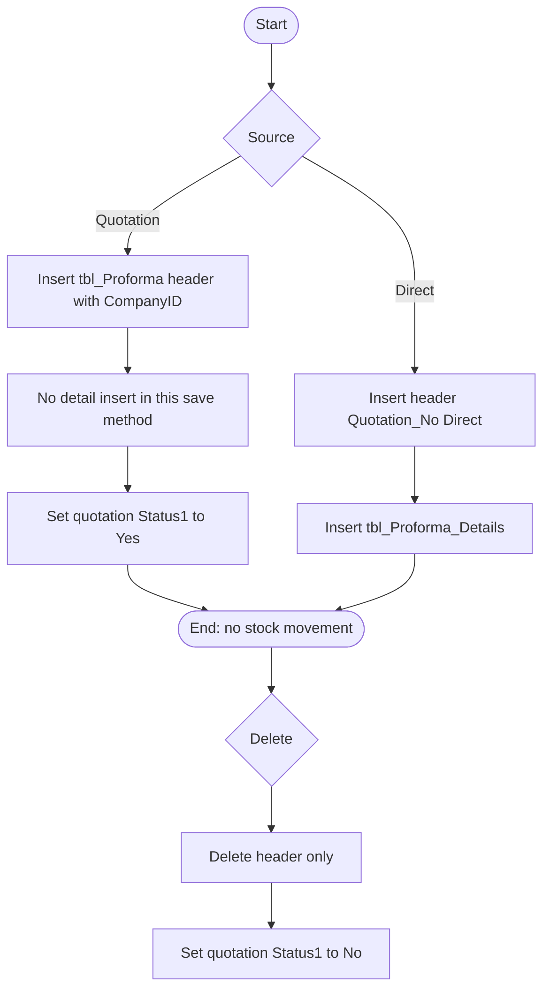

# 08 — Proforma invoice (PI)

## Document control

| Item | Value |
|------|--------|
| Review date | 2026-11-06 |
| Branch | `July_to_Sept26_DevNSupport` |
| HEAD | `026b36ee4e1d292fe7b4c8b81403cd309021af72` |
| Source | `Bill_Software/corporate/business/app/Add_proforma.aspx.cs`, `Bill_Software/corporate/business/app/Direct_Proforma.aspx.cs`, `Bill_Software/corporate/business/app/Delete_proforma.aspx.cs` |
| Status | Partially Implemented. Detail persistence needs UAT. |
| Limitation | A dedicated proforma view or search page was not in the reviewed list. Search is on the add and delete pages. |

Master index: [BUSINESS_PROCESS_MASTER_INDEX.md](BUSINESS_PROCESS_MASTER_INDEX.md).

## 1. Business purpose and scope

A proforma is a commercial invoice before the tax invoice. One page creates it from a quotation. Another creates it without a quotation. Neither page updates stock. **CONFIRMED IN SOURCE.**

Tax Invoice from a proforma reads `tbl_Proforma_Details` ([09](09_tax_invoice_ti.md)). The quotation-based save path reviewed here does not insert that table.

## 2. Sub-modules and pages

| Action | Page | Entry |
|--------|------|--------|
| Search quotations and save a header | `Add_proforma.aspx` | `btnSertch_Click`, `Button1_Click` |
| Build lines and save header plus details | `Direct_Proforma.aspx` | `btn_finalsave_Click` |
| Search and delete | `Delete_proforma.aspx` | `btnSertch_Click`, `DataList1_ItemCommand` |

View of a single proforma, other than the search grids, was **GAP / NOT IDENTIFIED** in this scope.

## 3. Actors

All three classes extend `System.Web.UI.Page`. No permission key is declared. Direct save stores `AddedById` from the user value that method already holds; this review does not add a role.

## 4. Preconditions

### From a quotation

- `tbl_Quotation` for `CompanyID`, joined to `tbl_Client` on `Client_Id` and `c.CompanyID = qut.CompanyID`.
- Header load: `SELECT * FROM tbl_Quotation WHERE Quotation_no = @QNo AND CompanyID = @CompanyID`.
- Next `Sl_no` from `tbl_Proforma` for the financial-date window and company.

### Direct

- Clients for the company.
- Categories from `tbl_NewparentProduct` with no `CompanyID` filter.
- Products from `tbl_NewProduct` where `DeleteMode = 0`, with no `CompanyID` filter on search or category bind.

## 5. User process

### Quotation-based (`Button1_Click`)

1. Search by client, date, or both. Results are company-scoped.
2. Select a quotation and review header amounts.
3. Save opens a transaction and inserts one `tbl_Proforma` row: invoice number and date, quotation number and date, client, gross, service tax, net, serial, subtotal, and `CompanyID`.
4. It sets `tbl_Quotation.Status1 = 'Yes'` for that quotation and company.
5. If the quotation has a `VisitId`, it sets `tbl_SalesVisitReport.IsProductive = 1` for the same company.
6. Commit. There is no `INSERT` into `tbl_Proforma_Details` in this method. **CONFIRMED IN SOURCE.**

### Direct (`btn_finalsave_Click`)

1. Select a client, add products, review.
2. Insert `tbl_Proforma` with `Quotation_No = 'Direct'`, GST flags, place of supply, and `mailStatus = 'Pending'`. The insert list has no `CompanyID`.
3. For each line, insert `tbl_Proforma_Details` (`Invoice_No`, `Sl_no`, `Product_id`, `Product_Code`, `Product_name`, `Quantity`, `Rate`, `Tax_Rate`, `Tax_Amount`, `Total_Amount`, `Net_Amount`, `Unit`, `ProductOrServiceCat`, `AddedById`). The insert list has no `CompanyID`, `ItemNo`, or `Proforma_No`.
4. The serial query uses the max proforma id in a date window and does not filter `CompanyID`.

### Delete

Search SQL is concatenated and has no `CompanyID`. Delete runs `delete from tbl_Proforma where Invoice_No=...` and `updatestock1`, which sets `tbl_Quotation.Status1 = 'No'` for the linked quotation number. The method name does not update stock. Details are not deleted by this command. There is no transaction. **CONFIRMED IN SOURCE.**

## 6. Process flow



## 7. Source files and methods

| File | Method | Lines |
|------|--------|-------|
| `Add_proforma.aspx.cs` | search SQL with company client join | 54–68 |
| `Add_proforma.aspx.cs` | `Button1_Click` | 236–288 |
| `Direct_Proforma.aspx.cs` | `btn_finalsave_Click` header and detail | 360–429 |
| `Direct_Proforma.aspx.cs` | product search | 86, 211 |
| `Delete_proforma.aspx.cs` | delete and `updatestock1` | 106–132 |

## 8. Header and detail discrepancy

| Writer | `tbl_Proforma` | `tbl_Proforma_Details` |
|--------|----------------|------------------------|
| `Add_proforma.Button1_Click` | Insert confirmed. Columns include `CompanyID` | No insert in the method |
| `Direct_Proforma.btn_finalsave_Click` | Insert confirmed. No `CompanyID` in the column list | Insert confirmed. No `CompanyID` in the column list |
| `Add_invoice.GetItemQueryByDocType` for `Proforma` | Not written here | Reads `Invoice_No`, `Product_id`, `Quantity`, `Rate`, `Tax_Rate`, `ProductOrServiceCat`, and filters `pd.CompanyID`. The select also references `pd.Proforma_No` and `pd.ItemNo` |

**CONFIRMED IN SOURCE:** the quotation-based save does not insert details, and the tax-invoice loader expects details.

**PENDING VERIFICATION:** this is not proof that every quotation-based proforma in the database lacks details. A trigger, an older page, or a manual script could write them. UAT should open a proforma created by `Add_proforma.aspx` and attempt to raise a tax invoice from it.

Direct rows may also fail the tax-invoice filter if `CompanyID` is null and the filter is `pd.CompanyID = @CompanyID`. Whether the column has a default is **PENDING VERIFICATION**. The tax-invoice select uses `pd.Proforma_No` and `pd.ItemNo`, which the direct insert does not populate. If those columns do not exist, the tax-invoice statement fails at runtime. If they exist and are null, the join and pending math use empty item numbers. Column existence was not read from the database.

## 9. Writes and transactions

| Path | Boundary |
|------|----------|
| Quotation-based save | One transaction: header, quotation status, optional visit flag |
| Direct save | Header and each detail row are separate `DbCL.SPExecDB` calls. `btn_finalsave_Click` does not open a `SqlTransaction`. A failure after the header insert does not roll the header back inside this method. **CONFIRMED IN SOURCE.** |
| Delete | Two independent `executeRdr` calls |

No path updates `tbl_NewProduct` or `tbl_stock`.

## 10. CompanyID

- Quotation search, quotation read, proforma header insert, quotation status, and visit update are company-scoped.
- Direct header, direct details, direct product search, and direct serial number are not company-scoped in the SQL text.
- Delete search, delete, and status reset are not company-scoped.

## 11. Inventory impact

None. Proforma quantity is not an issue or a receipt.

## 12. Financial impact

The header stores gross, tax, net, and subtotal copied from the quotation or calculated on the direct page. No due row and no payment row are created here. `Status1 = Yes` blocks quotation edit ([06](06_client_quotation_and_purchase_order.md)) until delete sets it back to `No`.

## 13. Document relationships

```text
tbl_Quotation.Quotation_no -> tbl_Proforma.Quotation_No
tbl_Proforma.Invoice_No -> tbl_Proforma_Details.Invoice_No
```

Direct proformas store the literal `Direct` in `Quotation_No`. Tax Invoice stores the proforma number in `tbl_Invoice.Quotation_No` when the user picks a proforma as the source ([09](09_tax_invoice_ti.md)).

## 14. Validation

- Quotation-based save uses parameters and a transaction.
- No reviewed check stops a second proforma for the same quotation.
- Direct save does not exclude another company's product.
- Delete does not check payments or tax invoices.

## 15. Open questions

- Do quotation-based proformas obtain details from anything other than `Button1_Click`? **PENDING VERIFICATION.**
- Do `tbl_Proforma_Details.CompanyID`, `Proforma_No`, and `ItemNo` exist, and are they populated for direct rows? **PENDING VERIFICATION.**
- Does delete leave detail rows behind? The reviewed delete statement does not remove them. **CONFIRMED IN SOURCE.**
- Direct header `@Gross` is the net total, the same value passed as `@Net`. Detail tax is calculated on quantity times rate and does not subtract the discount that the header loop calculates. **CONFIRMED IN SOURCE** in `btn_finalsave_Click`.

## 16. Related modules

- [06 Quotation](06_client_quotation_and_purchase_order.md)
- [07 Delivery challan](07_delivery_challan_dpcc.md)
- [09 Tax invoice](09_tax_invoice_ti.md)
