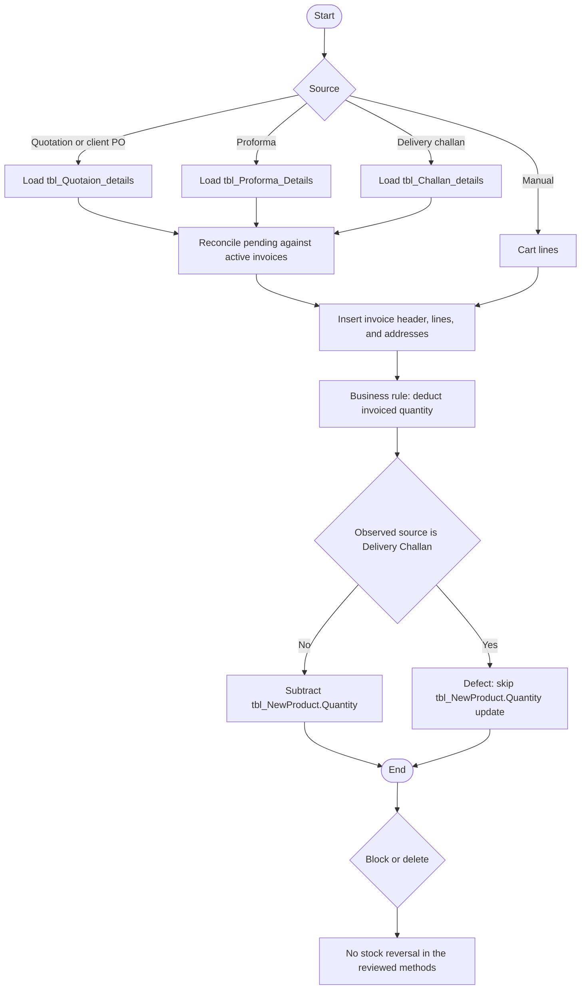

# 09 — Tax invoice (TI)

## Document control

| Item | Value |
|------|--------|
| Review date | 2026-11-06 |
| Branch | `July_to_Sept26_DevNSupport` |
| HEAD | `026b36ee4e1d292fe7b4c8b81403cd309021af72` |
| Source | `Bill_Software/corporate/business/app/Add_invoice.aspx.cs`, `Bill_Software/corporate/business/app/Manual_Invoice.aspx.cs`, `Bill_Software/corporate/business/app/Block_invoice.aspx.cs`, `Bill_Software/corporate/business/app/Delete_invoice.aspx.cs` |
| Status | Partially Implemented |
| Limitation | Business rule: every Tax Invoice deducts the invoiced quantity, including a delivery-challan source. Quotation, proforma, delivery challan, and payment do not deduct stock. The Delivery Challan skip in `Add_invoice.aspx.cs` is an implementation defect, not an approved exception. |

Master index: [BUSINESS_PROCESS_MASTER_INDEX.md](BUSINESS_PROCESS_MASTER_INDEX.md).

## 1. Business purpose and scope

Tax Invoice is the sales billing document and the stock deduction event.

Expected business behaviour: every Tax Invoice deducts the actual invoiced quantity, irrespective of source document (quotation, client-PO record, proforma, manual invoice, or DPCC). Quotation, proforma, the delivery challan, and payment do not deduct stock. DPCC records delivered quantity only ([07](07_delivery_challan_dpcc.md)).

Observed source behaviour: `Button1_Click` in `Bill_Software/corporate/business/app/Add_invoice.aspx.cs` subtracts `tbl_NewProduct.Quantity` when `docType != "Delivery Challan"`. When the source is Delivery Challan, that update is skipped. **CONFIRMED IN SOURCE** at lines 1175–1184. The skip is an implementation defect. It is not an approved business exception. Manual save always runs the subtraction (`Bill_Software/corporate/business/app/Manual_Invoice.aspx.cs`, `btnSave_Click`).

This deduction is not the purchase stock post in [02](02_purchase_and_inventory_receipt.md). Purchase updates `tbl_stock` and both product quantity columns. The tax-invoice statement updates only `tbl_NewProduct.Quantity`. The authoritative balance and read path remain **PENDING VERIFICATION**. The write-path matrix is in the [master index](BUSINESS_PROCESS_MASTER_INDEX.md).

## 2. Sub-modules and pages

| Action | Page | Entry |
|--------|------|--------|
| Select quotation, client PO, proforma, or delivery challan and save | `Add_invoice.aspx` | `btnSertch_Click`, `GetItemQueryByDocType`, `ReconcilePendingQuantities`, `Button1_Click` |
| Manual lines and save | `Manual_Invoice.aspx` | `btnSave_Click` |
| Set `status2` to `Block` | `Block_invoice.aspx` | `DataList1_ItemCommand` |
| Delete invoice rows | `Delete_invoice.aspx` | `DataList1_ItemCommand`, `updatestock1` |

Client PO metadata is the quotation header fields loaded when `docType` is `Purchase Order` (`FetchDocumentMetadata` reads `tbl_Quotation` for quotation and purchase-order types). It is not `tbl_PO_Header`. **CONFIRMED IN SOURCE** by the query branch. A vendor PO id is not selected.

## 3. Actors

The four classes extend `System.Web.UI.Page`. No permission key is declared. `AddedById` is `Session["USERID"]` or `System`. Salesperson is a dropdown from `tbl_login` for the company, excluding `admin` and `AT01`.

## 4. Preconditions

- Company context for client, address, numbering, and the source queries that include `@CompanyID`.
- A source document with a remaining pending quantity greater than zero, or a manual cart.
- Proforma source rows in `tbl_Proforma_Details` with `CompanyID`. See [08](08_proforma_invoice_pi.md): the quotation-based proforma save does not insert those rows.
- Challan source rows in `tbl_Challan_details` with `CompanyID`. See [07](07_delivery_challan_dpcc.md): challan insert omits that column.

## 5. User process

### From a source document

1. Choose Quotation, Purchase Order, Proforma, or Delivery Challan and search. Quotation and Purchase Order read `tbl_Quotation` with `RecordType` and `CompanyID`. Challan and proforma use their own headers and `CompanyID`.
2. Load lines with `GetItemQueryByDocType`, then replace the pending figures in `ReconcilePendingQuantities`.
3. If total pending is not greater than zero, the document is treated as fully invoiced.
4. The user edits quantities. `SyncGridToTable` writes the typed quantity into `PendingQty`. It does not compare it with the original pending value.
5. Save requires an external ERP date and a positive net.
6. One transaction inserts `tbl_Invoice` (`status1 = 'No'`, `status2 = 'Active'`), `tbl_Invoice_details`, billing and shipping `tbl_InvSiteAddress`, and a notification.
7. For each line with quantity `> 0`, the business rule requires a deduction of that invoiced quantity. The code subtracts `tbl_NewProduct.Quantity` where `ProductID` and `CompanyID` match only when `docType` is not `Delivery Challan`. The Delivery Challan branch is the defect.

### Manual

Same header and detail shape, with `Quotation_No` set from the PO field on the form. Every line runs the same `tbl_NewProduct.Quantity` subtraction. There is no source pending check.

### Block

Search is concatenated, status filter `status2 = 'Active'`, no `CompanyID`. Update sets `status2 = 'Block'` by invoice number only. No stock statement. **CONFIRMED IN SOURCE.**

### Delete

Company-scoped search. `updatestock1` sets `tbl_Quotation.Status2 = 'No'` and does not change stock. The older stock-reversal methods are commented out. Then three separate deletes remove `tbl_Invoice`, `tbl_Invoice_details`, and `tbl_InvSiteAddress` for the company. `UpdateQuotationProductStatus` can set detail `InvStatus = 'No'`. The deletes are not one transaction. **CONFIRMED IN SOURCE.**

## 6. Process flow

## 7. Source files and methods

| File | Method | Lines |
|------|--------|-------|
| `Bill_Software/corporate/business/app/Add_invoice.aspx.cs` | `GetItemQueryByDocType` | 646–692 |
| `Bill_Software/corporate/business/app/Add_invoice.aspx.cs` | `ReconcilePendingQuantities` | 707–762 |
| `Bill_Software/corporate/business/app/Add_invoice.aspx.cs` | `SyncGridToTable` | 1000–1022 |
| `Bill_Software/corporate/business/app/Add_invoice.aspx.cs` | `Button1_Click` stock branch | 1175–1184 |
| `Bill_Software/corporate/business/app/Manual_Invoice.aspx.cs` | `btnSave_Click` stock update | 474–478 |
| `Bill_Software/corporate/business/app/Block_invoice.aspx.cs` | status update | 109 |
| `Bill_Software/corporate/business/app/Delete_invoice.aspx.cs` | `updatestock1` and deletes | 147–168, 231–249 |

## 8. Matching and pending quantity

Quotation and client-PO lines come from `tbl_Quotaion_details` for the quotation number and company. The query does not filter `IsLatest` or `IsDeleted`. **CONFIRMED IN SOURCE.** Challan load does filter both ([07](07_delivery_challan_dpcc.md)).

`ReconcilePendingQuantities` then overwrites invoiced and pending amounts:

1. Prior invoice lines with an item number consume only the source line with the same item number (`ItemNosMatch` allows numeric equality).
2. Prior lines with a blank item number, or an item number that matched nothing, consume by product id or product code.
3. Pending becomes quoted minus consumed. The load path hides a document when the total pending is not greater than zero.

The quotation SQL also embeds a different pending expression before that method runs. The method's comment says it overwrites those placeholders. **CONFIRMED IN SOURCE.**

Save does not read the original pending value again. `SyncGridToTable` replaces `PendingQty` with the typed quantity, and `Button1_Click` inserts any typed quantity greater than zero. **CONFIRMED IN SOURCE.**

## 9. Tables and columns observed

### `tbl_Invoice` insert (`Add_invoice`)

`Invoice_No`, `Invoice_Date`, `Quotation_No`, `Client_ID`, `Gross`, `discount`, `sub_total`, `Service_Tax1`, `Net_Amount`, `Sl_no`, `Delivery_Amount`, `otherAmount1_name`, `otherAmount1`, `status1`, `status2`, `cgstOrsgst`, `igst`, `AddedById`, `CompanyID`, `SalesPersonCode`, `ExtInvoiceNo`, `ExtInvoiceDate`, `BillingAddress`, `PServiceName`.

`Quotation_No` receives the selected document number for every source type, including a challan number or a proforma number. **CONFIRMED IN SOURCE.**

Number format: `INV/C/` plus the April–March year token plus `/` plus the next `Sl_no` for the company.

### `tbl_Invoice_details` insert (`Add_invoice`)

`Invoice_No`, `Quotation_no`, `Product_id`, `Product_Code`, `Product_name`, `Quantity`, `sail_rate`, `discountRate`, `Service_tax_rate`, `Total_sail_rate1`, `Total_sail_rate2`, `specification`, `ItemNo`, `AddedById`, `CompanyID`.

`Product_id` is the source `TrueID` (quotation `Product_Code`, proforma `Product_id`, or challan `Product_id`). `Product_Code` is the source HSN / alternate code (`TrueHSN`).

### Stock update

`UPDATE tbl_NewProduct SET Quantity = CAST(... AS DECIMAL(18,2)) - @Qty WHERE ProductID = @TruePID AND CompanyID = @CompanyID`.

`Quantity_Num` and `tbl_stock` are not in the statement. Rows affected are not checked. There is no `Quantity >= @Qty` predicate. **CONFIRMED IN SOURCE.**

### Block and delete

`tbl_Invoice.status2`. Delete also uses `tbl_Invoice_details`, `tbl_InvSiteAddress`, `tbl_Quotation.Status2`, and `tbl_Quotaion_details.InvStatus`.

## 10. Writes and transactions

| Action | Boundary |
|--------|----------|
| Source or manual save | One transaction: number, header, details, stock updates, addresses, notification. Stock failure rolls back the invoice. |
| Block | One concatenated update. No stock. |
| Delete | Quotation status update and three deletes are separate calls. No stock update. |

## 11. CompanyID

Source search, line load, invoice number, header, details, stock update, and addresses on the add and manual pages pass `CompanyID`.

Block search and update do not. Delete search and deletes do. Delete's quotation status update passes `CompanyID`.

Quotation line load does not add `IsLatest`, so older versions with the same company id are included. **CONFIRMED IN SOURCE.**

## 12. Inventory impact

| Document | Expected | Observed |
|----------|----------|----------|
| Quotation, PI, DPCC save, payment | No deduction | No deduction. DPCC does not deduct stock |
| TI from quotation, client PO record, proforma, or manual | Deduct invoiced quantity | Subtract `tbl_NewProduct.Quantity` only. No `Quantity_Num` or `tbl_stock` update |
| TI from Delivery Challan | Deduct invoiced quantity | Skip in `Button1_Click` when `docType` is `Delivery Challan`. Defect |
| Block or delete TI | Not specified as a reversal in the reviewed rule | No reversal in the reviewed methods |

Purchase stock posting remains a separate write path ([02](02_purchase_and_inventory_receipt.md)). The authoritative balance and read path remain **PENDING VERIFICATION**.

## 13. Financial impact

The invoice stores gross, discount, tax, freight, other charges, and net. `status1` is inserted as `No`. The reviewed save does not insert `tbl_invoice_due` or `tbl_invoice_payment`. Receipts are [10](10_payment_received_ar.md) and are keyed by quotation, not by this invoice, except for a later stamp of `Invoice_No`.

Block sets `status2` to `Block`. `LoadPriorInvoiceLines` excludes `Block` in SQL and skips `Block` and `Cancelled` in the reader, so a blocked invoice stops consuming the pending quantity that `ReconcilePendingQuantities` writes. It does not put the stock back. The earlier placeholder SQL inside `GetItemQueryByDocType` counts only `status2 = 'Active'`; that placeholder is overwritten. **CONFIRMED IN SOURCE.**

## 14. Cross-source billing

Pending is calculated against invoices whose `Quotation_no` equals the document being billed. A quotation billed directly, a proforma billed as a proforma number, and a challan billed as a challan number do not share that key. The same commercial quantity can be invoiced once from each source. **INFERENCE** from the key that `Button1_Click` writes, and **CONFIRMED IN SOURCE** as the predicate in `GetItemQueryByDocType` / `LoadPriorInvoiceLines`.

A quotation invoice and a challan invoice can both exist. The business rule requires both to deduct invoiced quantity. The observed Delivery Challan skip means only the non-challan invoice deducts `tbl_NewProduct.Quantity`. The challan document itself still does not deduct stock.

## 15. Validation gaps

- Delivery Challan source skips `tbl_NewProduct.Quantity` deduction. That is a defect against the rule that every Tax Invoice deducts invoiced quantity.
- Original pending quantity is not enforced at save.
- Quotation lines are not limited to `IsLatest = 1` and `IsDeleted = 0`.
- Stock update allows a negative result and ignores zero rows affected.
- Services and products use the same update. A missing `ProductID` changes nothing and still saves the line.
- Block and delete do not restore quantity.
- Delete does not check for payments.

## 16. Related modules

- [02 Purchase stock](02_purchase_and_inventory_receipt.md) — different columns and event.
- [06 Quotation](06_client_quotation_and_purchase_order.md)
- [07 Delivery challan](07_delivery_challan_dpcc.md) — challan save does not deduct stock. The skip is on this invoice page.
- [08 Proforma](08_proforma_invoice_pi.md)
- [10 Payment received](10_payment_received_ar.md)
