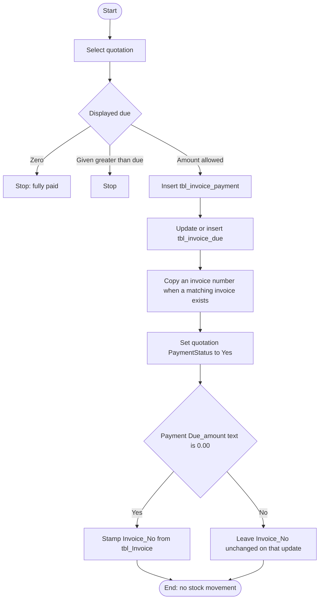

# 10 — Payment received (accounts receivable)

## Document control

| Item | Value |
|------|--------|
| Review date | 2026-11-06 |
| Branch | `July_to_Sept26_DevNSupport` |
| HEAD | `026b36ee4e1d292fe7b4c8b81403cd309021af72` |
| Source | `Bill_Software/corporate/business/app/add_payment.aspx.cs`, `Bill_Software/corporate/business/app/Delete_payment.aspx.cs`, `Bill_Software/corporate/business/app/PaymentsReceived.aspx.cs` |
| Status | Partially Implemented |
| Limitation | Receipts are selected against a quotation. They are not allocated to a chosen tax invoice. |

Master index: [BUSINESS_PROCESS_MASTER_INDEX.md](BUSINESS_PROCESS_MASTER_INDEX.md).

## 1. Business purpose and scope

A user records money received against a quotation, reduces the outstanding due, and can delete that receipt. Fully settled receipt rows can be searched. No stock column is updated. **CONFIRMED IN SOURCE.**

This is not the vendor payment in [03](03_purchase_payment_ap.md). The tables are `tbl_invoice_payment` and `tbl_invoice_due`.

## 2. Sub-modules and pages

| Action | Page | Entry |
|--------|------|--------|
| Search quotations, show due and prior receipts, save | `add_payment.aspx` | `btnSertch_Click`, `Button1_Click`, `InserttotalDate`, `insertdue` |
| Search and delete | `Delete_payment.aspx` | `DataList1_ItemCommand`, `updatedue` |
| Search receipts whose due is `0.00` | `PaymentsReceived.aspx` | `btnSertch_Click` |

Prior receipts on the add page are the view of payments for the selected quotation (`Bindpriviouspayment`: `Payment_ID`, `Payment_Date`, `Given_amount`, `type`). There is no separate invoice picker.

## 3. Actors

All three classes extend `System.Web.UI.Page`. No permission key is declared.

`add_payment` loads client names with `CompanyID`. `Delete_payment` and `PaymentsReceived` load client names with no `CompanyID`.

## 4. Preconditions

- A `tbl_Quotation` row. Add-page search filters `tbl_Quotation.CompanyID`.
- Due is read from `tbl_invoice_due` by `qutation_no`. The due query has no `CompanyID`. If no row exists, the first save inserts one (`insertdue`).
- The form blocks a new receipt when the displayed due is 0, and when the given amount is greater than the due.

The due used on first receipt is whatever `Binddue` loaded. This review did not find a tax-invoice save that inserts `tbl_invoice_due` ([09](09_tax_invoice_ti.md)). Quotation edit can overwrite due with the quotation net ([06](06_client_quotation_and_purchase_order.md)). Where the first due comes from, when no row exists yet, depends on `Binddue` returning a value the form can parse. An empty due is **PENDING VERIFICATION** against the page markup, which was not the behaviour source.

## 5. User process

1. Search quotations by client and/or date. The add page includes `CompanyID` on the quotation, client, and service joins.
2. Select a quotation. Load header, prior payments, and due.
3. Enter the amount and the instrument (cash, bank, or online by radio index).
4. `Button1_Click` rejects due `== 0` and given amount greater than due.
5. `InserttotalDate` inserts `tbl_invoice_payment`, then updates or inserts `tbl_invoice_due`, then copies an invoice number when one exists, then runs two further updates.
6. Delete adds `Given_amount` back to due, or deletes the due row when the stored due is 0. It then deletes the payment. If no other payment remains for the quotation, it sets `PaymentStatus` to `No`.

`PaymentsReceived` only lists payments where `Due_amount = '0.00'`. It does not insert or update. **CONFIRMED IN SOURCE.**

## 6. Partial payment and final payment

| Behaviour | What the code does | Label |
|-----------|--------------------|-------|
| Partial receipt | Allowed while given amount is less than or equal to the displayed due and due is not 0. New due is previous due minus given amount, stored on `tbl_invoice_due` and on the payment row | CONFIRMED IN SOURCE |
| Outstanding due | `tbl_invoice_due.Due_amount` for `qutation_no` | CONFIRMED IN SOURCE |
| Final receipt | The form accepts a given amount equal to the due. Due becomes 0 | CONFIRMED IN SOURCE |
| `PaymentStatus` | `InserttotalDate` sets `tbl_Quotation.PaymentStatus = 'Yes'` after every successful save, including a partial receipt. It is not inside a "due is zero" condition | CONFIRMED IN SOURCE |
| Invoice link when due text is `0.00` | A separate update copies `tbl_Invoice.Invoice_No` onto payment rows whose `Invoice_No` is null and whose `Due_amount` equals the literal `0.00` | CONFIRMED IN SOURCE |

`due.ToString()` is not formatted as `0.00`. A final payment can store a due string other than `0.00` and miss the invoice stamp. **INFERENCE** from `ToString()` plus the literal comparison. Confirm with a saved row. **PENDING VERIFICATION.**

`PaymentStatus = Yes` therefore does not, by itself, mean the quotation is fully paid. The due row is the outstanding balance the form checks.

## 7. Process flow

Delete is a separate path: restore or remove due, delete the payment, and set `PaymentStatus` to `No` only when no other payment remains for that quotation number.

## 8. Source files and methods

| File | Method | Lines |
|------|--------|-------|
| `add_payment.aspx.cs` | `Button1_Click` | 244–263 |
| `add_payment.aspx.cs` | `InserttotalDate` | 266–372 |
| `add_payment.aspx.cs` | `insertdue` | 426–451 |
| `add_payment.aspx.cs` | `updatedetails` | 374–394 |
| `add_payment.aspx.cs` | search with `CompanyID` | 52–79 |
| `Delete_payment.aspx.cs` | `DataList1_ItemCommand` | 105–131 |
| `Delete_payment.aspx.cs` | due restore | 173–199 |
| `PaymentsReceived.aspx.cs` | search `Due_amount='0.00'` | 29–46 |

## 9. Tables and columns observed

### `tbl_invoice_payment` insert

`Payment_ID`, `Payment_Date`, `Quotation_No`, `Quotation_Date`, `Client_Id`, `Sub_total`, `Service_tax`, `Net_amount`, `Given_amount`, `type`, `Ch_no`, `Ch_bank`, `Ch_date`, `Due_amount`, `subtotal`, `tds`, `currancy`.

`Invoice_No` is not in the insert. It is commented out. `updatedetails` and the later stamp write it afterwards. **CONFIRMED IN SOURCE.**

`@tds` is set from `RadioButtonList2.Text` (the instrument), not from `txttdsamount`. `insertdsdetails` inserts `tbl_invoice_payment_tds` but is not called from `InserttotalDate`. **CONFIRMED IN SOURCE.**

### `tbl_invoice_due`

`qutation_no`, `Due_amount`. Updated or inserted by quotation number. No `CompanyID` in the statement.

### Quotation and invoice

`tbl_Quotation.PaymentStatus`. `tbl_Invoice.Invoice_No` and `Quotation_No` are read to stamp the payment. The stamp joins every unpaid-null payment to an invoice with the same quotation number and company, and it has no filter to the payment just inserted. **CONFIRMED IN SOURCE** at line 364.

`Delete_payment` can set `tbl_Invoice.status1 = 'No'` from `CheckOtherPayExit` when `Session["invno"]` is set. The reviewed add method does not set `Session["invno"]`. **CONFIRMED IN SOURCE** for the delete method. When the session value is set was **GAP / NOT IDENTIFIED** in the add method.

## 10. Writes and transactions

Insert, due update, invoice copy, payment-status update, and invoice stamp are separate command executions. They are not one `SqlTransaction`. A failure after the insert leaves a receipt without a matching due change. **CONFIRMED IN SOURCE.**

Delete updates due, deletes the payment, and maybe updates `PaymentStatus` as separate concatenated statements. No `CompanyID` on those statements.

Payment ids use `max(ID)` plus one (`BindpaymentId`), outside a transaction.

## 11. CompanyID

| Statement | Company predicate |
|-----------|-------------------|
| Add-page quotation search and quotation header | Yes |
| Payment insert | Column not present |
| Due read and write | No |
| `PaymentStatus` update | Yes |
| Invoice stamp | `tbl_Invoice.CompanyID` only |
| Delete search, delete, due restore, `PaymentStatus` reset | No |
| `PaymentsReceived` search | No |

## 12. Inventory impact

None.

## 13. Financial impact

- The receipt stores the amount received and the due remaining after that receipt.
- Outstanding due for the next receipt is `tbl_invoice_due`, not the sum of invoice balances.
- Several invoices can share one quotation number. The receipt is not tied to one of them at insert. The stamp can copy an invoice number onto every payment for that quotation whose invoice is null and whose due text is `0.00`.
- `PaymentStatus = Yes` is written for partial and final receipts.
- No ledger, bank, or allocation table is written by these methods. **GAP / NOT IDENTIFIED.**
- Vendor AP ([03](03_purchase_payment_ap.md)) uses `tbl_Purchess_payment` and `tbl_purches_due` and is not updated here.

## 14. Quotation-centric allocation

The user picks a quotation. The payment's commercial key is `Quotation_No`. Tax invoice identity is optional and late:

- `updatedetails` reads one invoice for the quotation (`if (re.Read())`, so the first row the server returns) and copies its number and date onto payments for that quotation.
- The `0.00` update can attach invoice numbers across all such unsettled-null payments for the company.

There is no reviewed screen to split one receipt across invoices or to apply a receipt to an invoice that has no quotation. Manual invoices store a quotation/PO text in `Quotation_No` ([09](09_tax_invoice_ti.md)); whether a receipt can select that text depends on it existing as `tbl_Quotation.Quotation_no`. **PENDING VERIFICATION** for manual-invoice numbers that are not quotation numbers.

## 15. Validation and risks

- Over-receipt is blocked only against the displayed due.
- Due and payment writes are not atomic and are not company-scoped.
- Delete concatenates ids and amounts into SQL.
- `PaymentStatus` does not record partial versus final.
- The invoice stamp is not limited to the current payment id.
- Deleting a purchase-side payment is a different page and must not be used for these rows.

## 16. Related modules

- [03 Purchase payment](03_purchase_payment_ap.md)
- [06 Quotation](06_client_quotation_and_purchase_order.md)
- [09 Tax invoice](09_tax_invoice_ti.md)
