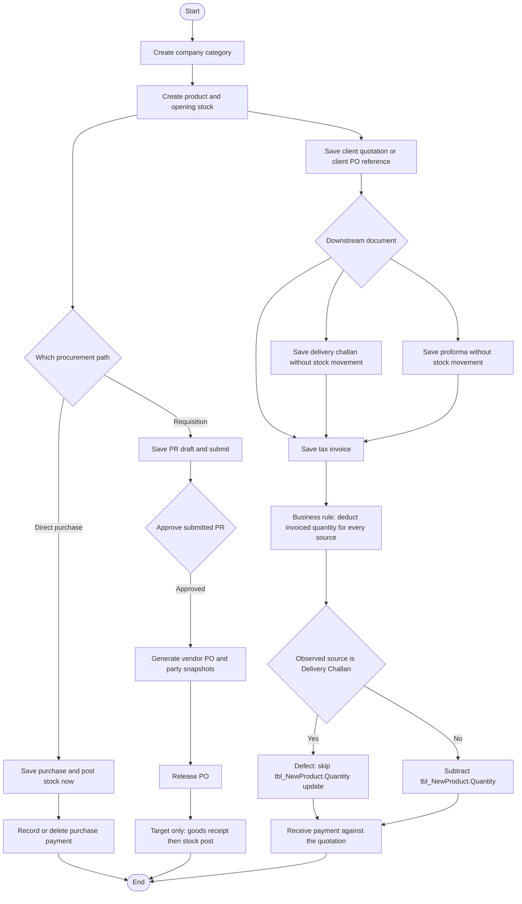

# FLMX Business Process Master Index

## Document control

| Item | Value |
|------|--------|
| Review date | 2026-11-06 |
| Branch | `July_to_Sept26_DevNSupport` |
| HEAD | `026b36ee4e1d292fe7b4c8b81403cd309021af72` (`026b36e` Merge branch `feature/add-proforma-ui-refactor`) |
| Source scope | Code-behind under `Bill_Software/corporate/business/app/`, listed in each module. `po_view.aspx` and `po_view.aspx.cs` are not in the repository. The located PO list and release pages are `Bill_Software/corporate/business/app/View_PO.aspx.cs` and `Bill_Software/corporate/business/app/View_PO_Details.aspx.cs`. |
| Status | Documentation only. No application, SQL, or schema change. |
| Database | Live metadata was not queried in this pass. Stored-procedure bodies, triggers, defaults, indexes, and foreign keys are **Database Verification Pending**. |

The reviewed `.aspx.cs` files were not listed as locally modified. Unrelated dirty files (`Web.config`, a publish profile, `newproduct_master.aspx` markup, `packages.config`) were not used as behaviour evidence.

## 1. Scope

This set describes the commercial lifecycle that the reviewed pages actually implement:

1. Product category and products
2. Direct purchase and the stock it posts
3. Payment against purchase (accounts payable)
4. Purchase requisition and vendor purchase order
5. Goods receipt (not identified)
6. Client quotation, including a client PO/DO reference stored on the quotation
7. Delivery challan (DPCC)
8. Proforma invoice (PI)
9. Tax invoice (TI)
10. Payment received (accounts receivable)

Two stock write paths exist and must stay separate. Which column or table is the authoritative balance, and which screens read it, remains **PENDING VERIFICATION**. No trigger or background synchronization is inferred.

- Direct purchase updates `tbl_stock` and `tbl_NewProduct` when the purchase is saved. See the write-path matrix in section 7.
- Business rule: every Tax Invoice deducts the invoiced quantity from stock, whether the source is a quotation, a proforma, a manual invoice, or a delivery challan (DPCC).
- Observed code: `Bill_Software/corporate/business/app/Add_invoice.aspx.cs` `Button1_Click` subtracts `tbl_NewProduct.Quantity` only when `docType != "Delivery Challan"`. That skip is an implementation defect. It is not an approved exception. The challan page itself does not deduct stock.

Quotation, proforma, the delivery challan save, and both payment pages do not deduct stock. Vendor PO release is not goods receipt. No GRN page, table, or stock-posting procedure was identified in the reviewed source.

A client PO number stored on `tbl_Quotation` (`PO_Number`, `DO_Number`, `RecordType`) is not the internally generated procurement PO (`tbl_PO_Header`).

## 2. Evidence classification

Every finding in the module documents uses one of these labels:

| Label | Meaning |
|-------|---------|
| CONFIRMED IN SOURCE | Observed in the inspected code-behind: page, method, SQL text, or control flow. |
| CONFIRMED BY DATABASE | Read from the live database. None in this pass. |
| REPORTED IN PRIOR AUDIT | Taken from an existing audit or catalog, and marked as such. This pass does not treat catalogs as proof of code behaviour. |
| INFERENCE | A reading that the source suggests but does not state. |
| GAP / NOT IDENTIFIED | Searched in the reviewed files and not found. Absence outside those files is not proven. |
| PENDING VERIFICATION | Source names an object or effect whose body, constraint, or data outcome was not verified. |

Where a business rule is uncertain, the document records the code behaviour and leaves the rule open.

## 3. Limitations

- Stored procedures are confirmed only as call sites and parameter lists. Their internal writes are **PENDING VERIFICATION**.
- No trigger, default, check constraint, or foreign key is treated as verified.
- Pages outside the named set (print layouts, reports, `View_PR_Details.aspx`) were not reviewed. A redirect to an unreviewed page is recorded as navigation, not as that page's behaviour.
- Permission keys are recorded only where the code-behind declares `SecurePage` and `RequiredPermissionKey`. Other reviewed pages declare `System.Web.UI.Page`. Menu labels are not roles.
- `CompanyID` is reported only where the SQL text includes it.

## 4. Lifecycle in review order

```text
Product category -> Product master (opening quantity on product and stock)
    -> Direct purchase (posts stock immediately) -> Purchase payment
    and, separately
    -> Purchase requisition -> Approval -> Vendor PO -> Release
    -> Goods receipt (not identified)
Client quotation / client PO reference (no stock movement)
    -> Delivery challan and/or Proforma (no stock movement)
    -> Tax invoice (business rule: deduct invoiced quantity for every source; observed DPCC-source skip is a defect)
    -> Payment received against the quotation (no stock movement)
```

## 5. Navigation matrix

Page files below are `Bill_Software/corporate/business/app/<name>.aspx` with code-behind `<name>.aspx.cs`, unless a module names a different path.

| # | Module | Document | Pages confirmed in the reviewed scope |
|---|--------|----------|----------------------------------------|
| 01 | Product category and products | [01_product_category_and_products.md](01_product_category_and_products.md) | Create/list/delete category: `newproductparent.aspx`. Create/edit/search/soft-delete product: `newproduct_master.aspx`. |
| 02 | Purchase and inventory receipt | [02_purchase_and_inventory_receipt.md](02_purchase_and_inventory_receipt.md) | Create: `Purches_exting_vendor.aspx`. Search/edit: `EditPurchase.aspx`. Search/delete: `Delete_purtches.aspx`. |
| 03 | Purchase payment (AP) | [03_purchase_payment_ap.md](03_purchase_payment_ap.md) | Add/search: `add_payment_purchess.aspx`. Search/delete: `Delete_purches_payment.aspx`. Optional payment also inside purchase save. |
| 04 | Purchase requisition and vendor PO | [04_purchase_requisition_and_po.md](04_purchase_requisition_and_po.md) | Create/submit/cancel draft: `RequisitionNew.aspx`. Approve list: `Approve_PR.aspx`. PO generation list: `Generate_PO_From_PR.aspx`. Preview/create: `Generate_PO_Preview.aspx`. List: `View_PO.aspx`. Review/release: `View_PO_Details.aspx`. |
| 05 | Goods receipt (GRN) | [05_goods_receipt_grn.md](05_goods_receipt_grn.md) | None. Gap. |
| 06 | Client quotation and client PO reference | [06_client_quotation_and_purchase_order.md](06_client_quotation_and_purchase_order.md) | Create: `Create_quotation.aspx`. Search/edit/save-as-new: `Edit_quatation.aspx`. Search: `Seartch_quotation.aspx`. View/export: `View_quotation.aspx`. |
| 07 | Delivery challan (DPCC) | [07_delivery_challan_dpcc.md](07_delivery_challan_dpcc.md) | Create from quotation: `add_chalan.aspx`. |
| 08 | Proforma invoice (PI) | [08_proforma_invoice_pi.md](08_proforma_invoice_pi.md) | From quotation: `Add_proforma.aspx`. Direct: `Direct_Proforma.aspx`. Delete/search: `Delete_proforma.aspx`. |
| 09 | Tax invoice (TI) | [09_tax_invoice_ti.md](09_tax_invoice_ti.md) | From quotation, client PO, proforma, or DPCC: `Add_invoice.aspx`. Manual: `Manual_Invoice.aspx`. Block: `Block_invoice.aspx`. Delete: `Delete_invoice.aspx`. |
| 10 | Payment received (AR) | [10_payment_received_ar.md](10_payment_received_ar.md) | Add against quotation: `add_payment.aspx`. Delete: `Delete_payment.aspx`. Fully-due search: `PaymentsReceived.aspx`. |

## 6. Dependencies

| Module | Upstream | Downstream | Creates / updates / consumes / reverses |
|--------|----------|------------|------------------------------------------|
| 01 Category and product | Company context; category before product | Purchase, PR, quotation, direct PI, manual TI | Creates opening `tbl_NewProduct` quantity and one `tbl_stock` row. Edit updates product quantity only. Soft-delete hides the product and does not reverse stock. |
| 02 Direct purchase | Vendor, product or service, ship-to store | AP payment; physical quantity | Creates purchase, lines, due, and optional payment. Increases stock immediately for product lines. Edit of an existing line does not adjust stock. New lines on edit adjust `tbl_stock.Quantity` only. Delete decreases `tbl_stock.Quantity` and `tbl_NewProduct.Quantity`. |
| 03 AP | Purchase and `tbl_purches_due` | None in the reviewed pages | Creates or deletes a vendor payment and updates due. No stock movement. |
| 04 PR and vendor PO | Vendor, product or service | Release. Not GRN. | Creates PR and PO documents. No stock statement in the reviewed pages. |
| 05 GRN | Released PO, conceptually | Stock posting, conceptually | Not identified. |
| 06 Client quotation | Client, category, product | DPCC, PI, TI, AR | Creates or versions quotation lines and a client PO/DO reference. No stock movement. |
| 07 DPCC | Quotation latest lines | TI may bill the challan | Records delivered quantity. Does not deduct stock. |
| 08 PI | Quotation, or products for a direct PI | TI expects `tbl_Proforma_Details` | Creates a proforma header. Detail persistence differs by page. No stock movement. |
| 09 TI | Quotation, client-PO record type, PI, or DPCC; or a manual cart | AR may later stamp an invoice number | Business rule: deduct invoiced quantity for every source. Observed code deducts `tbl_NewProduct.Quantity` except when the source type is Delivery Challan. That skip is a defect. Block and delete do not restore quantity. |
| 10 AR | Quotation net amount and `tbl_invoice_due` | Invoice number is copied onto the payment in some cases | Creates or deletes a customer receipt and updates due. No stock movement. |

## 7. Inventory and financial effects

| Event | Inventory | Financial document |
|-------|-----------|--------------------|
| Product create | Inserts `tbl_NewProduct.Quantity` / `Quantity_Num` and `tbl_stock.Quantity` at store `STR001` | None |
| Product edit | Updates `tbl_NewProduct` quantity columns only | None |
| Direct purchase save, product lines | `UpdateStock` adds to `tbl_stock` and `tbl_NewProduct`, including `Quantity_Num` | `tbl_Purches`, `tbl_purches_due`, optional `tbl_Purchess_payment` |
| Edit existing purchase line | Detail update only. No stock call in `gd_Service_Product_RowUpdating` | Header update is a separate method |
| Add lines on an existing purchase | `AdjustStockDelta` changes `tbl_stock.Quantity` only | Header totals recalculated after commit |
| Delete purchase | Subtracts `tbl_stock.Quantity` and `tbl_NewProduct.Quantity`. Does not update `Quantity_Num` | Deletes due, lines, and header. Does not delete payments |
| AP add / delete | None | Inserts or deletes `tbl_Purchess_payment` and updates `tbl_purches_due` |
| PR, PO generate, PO release | No stock SQL in the reviewed pages | No AP posting in the reviewed pages |
| GRN | Not identified | Not identified |
| Quotation, DPCC, PI, AR | None | Quotation and PI are commercial documents. AR writes `tbl_invoice_payment` and `tbl_invoice_due` |
| TI from quotation, client PO, proforma, or manual | Subtracts `tbl_NewProduct.Quantity` only. Does not update `Quantity_Num` or `tbl_stock` | Inserts `tbl_Invoice` and `tbl_Invoice_details` |
| TI from Delivery Challan | Business rule requires the same deduction of invoiced quantity. Observed `Button1_Click` skips the update. Defect, not an approved exception. The challan save does not deduct stock | Same invoice insert |
| Block or delete TI | No stock reversal in the reviewed methods | Block sets `status2`. Delete removes invoice rows and sets quotation `Status2` to `No` |

### Inventory write-path consistency

Column names below are the names in the reviewed SQL. Database column types were not read from a catalog. The authoritative stock balance and the read path that uses it remain **PENDING VERIFICATION**. Nothing below infers a trigger or a sync job.

| Event | `tbl_NewProduct.Quantity` | `tbl_NewProduct.Quantity_Num` | `tbl_stock.Quantity` | Label |
|-------|---------------------------|-------------------------------|----------------------|-------|
| Product create | Inserted | Inserted | Inserted at store `STR001`. That insert does not set `Quantity_Num` | CONFIRMED IN SOURCE |
| Product edit | Updated | Updated | Not updated | CONFIRMED IN SOURCE |
| Direct purchase save, product line | Added, then rewritten from `Quantity_Num` in the same `UPDATE` | Added | Added, or inserted when no store row matches | CONFIRMED IN SOURCE |
| Edit an existing purchase line | Not updated | Not updated | Not updated. `gd_Service_Product_RowUpdating` does not call `AdjustStockDelta` | CONFIRMED IN SOURCE |
| Add a line on an existing purchase | Not updated | Not updated | `AdjustStockDelta` adds the new quantity only | CONFIRMED IN SOURCE |
| Delete purchase | Subtracted | Not in the `UPDATE` | Subtracted | CONFIRMED IN SOURCE |
| Tax Invoice from quotation, client PO, proforma, or manual | Subtracted. `Quantity_Num` and `tbl_stock` are not in the statement | Not in the statement | Not in the statement | CONFIRMED IN SOURCE |
| Tax Invoice from a delivery challan | Business rule: subtract the invoiced quantity. Observed code skips the `UPDATE` when `docType` is `Delivery Challan` | Not written | Not written | Defect against the business rule. Skip is CONFIRMED IN SOURCE |
| Delivery challan save | Not written | Not written | Not written | CONFIRMED IN SOURCE |

## 8. End-to-end flow

Existing behaviour and the GRN gap are drawn together. The GRN node is a target state. It is not an implemented page.



## 9. Status matrix

| Module | Status | Why |
|--------|--------|-----|
| 01 Category and products | Implemented | Create, duplicate check, edit, and soft-delete are in source. Opening stock and later purchase/invoice stock use different columns and stores. Warehouse meaning is unresolved. |
| 02 Direct purchase | Partially Implemented | Save, edit, and delete exist. Existing-line edits do not adjust stock. `Quantity` and `Quantity_Num` diverge across save, edit, and delete. |
| 03 Purchase payment | Partially Implemented | Add and delete update due in source. No `CompanyID`, and the due update is not in the same transaction as the payment insert. |
| 04 PR and vendor PO | Partially Implemented | Draft, submit, approve, generate, snapshot, and release call sites are in source. Procedure bodies are pending. Reject is not implemented on `Approve_PR.aspx.cs`. |
| 05 GRN | Gap | Not identified in the reviewed scope. |
| 06 Client quotation | Partially Implemented | Create, version, and save-as-new exist. Edit and save-as-new omit `CompanyID` on several writes. |
| 07 DPCC | Partially Implemented | Pending quantity is calculated on load. Save does not recalculate it inside the transaction, and the inserts omit `CompanyID`. |
| 08 Proforma | Partially Implemented | Quotation-based save inserts a header and no details. Direct save inserts details. Tax Invoice reads `tbl_Proforma_Details`. Outcome needs UAT. |
| 09 Tax invoice | Partially Implemented | Business rule: every Tax Invoice deducts invoiced quantity. Observed DPCC-sourced invoices skip that update; the skip is a defect. Save does not enforce the loaded pending quantity. Block and delete do not reverse stock. |
| 10 Payment received | Partially Implemented | Receipts are quotation-centric. `PaymentStatus` is set to `Yes` on every save in `InserttotalDate`, including a partial receipt. |

## 10. Related documents

- [01 Product category and products](01_product_category_and_products.md)
- [02 Purchase and inventory receipt](02_purchase_and_inventory_receipt.md)
- [03 Purchase payment](03_purchase_payment_ap.md)
- [04 Purchase requisition and vendor PO](04_purchase_requisition_and_po.md)
- [05 Goods receipt gap](05_goods_receipt_grn.md)
- [06 Client quotation](06_client_quotation_and_purchase_order.md)
- [07 Delivery challan](07_delivery_challan_dpcc.md)
- [08 Proforma](08_proforma_invoice_pi.md)
- [09 Tax invoice](09_tax_invoice_ti.md)
- [10 Payment received](10_payment_received_ar.md)
- Solution map: [../SOLUTION_INDEX.md](../SOLUTION_INDEX.md)
